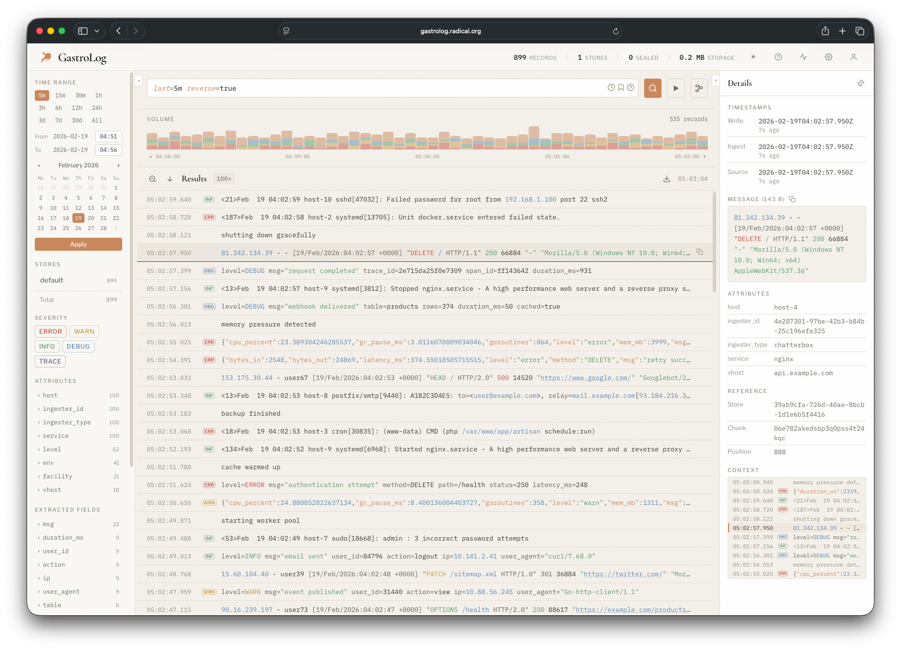

# GastroLog

> **This project is under heavy development.** File formats, wire protocols, configuration schemas, and storage layouts are **not stable** and may change without notice. Until version 1.0, expect breaking changes between releases. Do not rely on any internal format for long-term data retention.

GastroLog is a log aggregation and search service. It collects logs from various sources, stores them in time-ordered chunks, and builds indexes for fast full-text search and interactive analytics.



## Features

- **Multiple ingesters** — Syslog (UDP/TCP), HTTP (Loki-compatible), RELP, OTLP (gRPC/HTTP), Fluent Forward, Kafka, MQTT (v3.1.1/v5), file tail, Docker container logs, self-monitoring, internal metrics, and built-in test generators (chatterbox, scatterbox)
- **Vaults** — Vaults hold append-only chunks that seal automatically, trigger index builds, and come in three storage shapes: memory, local disk, and cloud-backed (S3/Azure/GCS, uploaded as separately compressed frames so a reader range-fetches only the section it needs). Each vault keeps as many copies as its replication factor
- **Full-text search** — Token, attribute, and key-value indexes with a purpose-built query language supporting boolean logic, comparisons, regex, and globs
- **Pipeline analytics** — Pipe-based query transformations (`| stats`, `| timechart`, `| eval`, `| sort`, `| head`, `| tail`, `| slice`, `| where`, `| rename`, `| fields`, `| dedup`, `| lookup`, `| export`, `| raw`) with 10 aggregation functions, 28 scalar functions, time bucketing, and arithmetic expressions
- **Field enrichment** — Built-in `rdns` (reverse DNS) and `useragent` (user-agent parser) lookup tables, plus configurable MMDB (GeoIP/ASN with auto-download), CSV, JSON and YAML (with jq transform), HTTP, and static lookup tables
- **Visualizations** — Line charts, bar charts, donut charts, heatmaps, scatter plots, world maps (choropleth and point), single-value displays, and sortable tables with CSV/JSON export — auto-detected or explicitly selected via `| linechart`, `| barchart`, `| donut`, `| heatmap`, `| scatter`, `| map`
- **Routing** — Route records to vaults by match expression, in priority order, with fanout, round-robin, or failover distribution across a route's destinations
- **Rotation and retention policies** — Per-vault control over when chunks seal and when they expire; on expiry a vault deletes the records, routes them through the routing table again, or transfers the sealed chunk to another vault
- **Embedded web UI** — Single binary serves both the API and the frontend
- **Clustering** — Raft consensus for configuration and for each vault's chunk metadata, transparent forwarding of writes to the leader, cross-node search with merged results, record bytes pulled to every node that homes a vault, non-voter members, and auto-generated mTLS for all inter-node communication
- **Authentication** — JWT-based with configurable password policies and user management

## Quick Start

GastroLog runs the same way in containers and on bare metal. Pick the path that matches your environment:

| Path | Best for | Recipe |
|---|---|---|
| **Single-node `docker run`** | Try it in 30 seconds | [docs/deployment/quickstart.md](./docs/deployment/quickstart.md) |
| **Docker Compose** | Local multi-node cluster | [docs/deployment/docker-compose.md](./docs/deployment/docker-compose.md) |
| **Docker Swarm** | Multi-host orchestration without K8s | [docs/deployment/docker-swarm.md](./docs/deployment/docker-swarm.md) |
| **Kubernetes** | StatefulSet + per-pod DNS, anywhere K8s runs | [docs/deployment/kubernetes.md](./docs/deployment/kubernetes.md) |
| **Podman** | Daemonless / rootless containers | [docs/deployment/podman.md](./docs/deployment/podman.md) |
| **Uncontainerized** | Release binary, systemd, dev cluster | [docs/deployment/uncontainerized.md](./docs/deployment/uncontainerized.md) |

The fastest path:

```sh
docker run --rm -p 4564:4564 \
  -v gastrolog-config:/config -v gastrolog-vaults:/vaults \
  -e GASTROLOG_INITIAL_ADMIN_USER=admin \
  -e GASTROLOG_INITIAL_ADMIN_PASSWORD=change-me \
  ghcr.io/kluzzebass/gastrolog:latest
```

Open http://localhost:4564 and log in as `admin` / `change-me`.

Configuration via environment variables is documented in [`docs/container_environment.md`](./docs/container_environment.md). For the binary's CLI flags, run `gastrolog server --help` or see [docs/deployment/uncontainerized.md](./docs/deployment/uncontainerized.md).

### With Homebrew

```sh
brew install kluzzebass/tap/gastrolog
gastrolog server
```

## Usage

```
gastrolog server [flags]          Start the service
gastrolog query <expression>      Search logs (streams results to stdout)
gastrolog config <entity>         Manage vaults, ingesters, routes, policies, cloud services, nodes, certificates, files, settings
gastrolog cluster <action>        Cluster lifecycle (status, health, join-token, join, remove-node, promote/demote, shutdown, ...)
gastrolog user <action>           Manage users (list, get, create, delete, reset-password)
gastrolog login                   Get a JWT token (for scripting remote access)
gastrolog register                Bootstrap the first admin user
gastrolog inspect <vault|chunk|storage>  Inspect vaults, chunks, and storages
gastrolog alerts                  List standing alarms across the cluster
gastrolog seal <vault>            Seal the vault's open chunks and start new ones
gastrolog reindex <vault>         Rebuild all indexes for sealed chunks
gastrolog pause <vault>           Pause ingestion for a vault
gastrolog resume <vault>          Resume ingestion for a vault
gastrolog validate <vault>        Check a vault's chunks, indexes and cloud objects for damage
gastrolog reconcile <vault>       Rebuild each node's cloud index from the object store
gastrolog archive <chunk-id>      Archive a cloud-backed chunk to offline storage
gastrolog restore <chunk-id>      Restore an archived chunk to readable storage
gastrolog repatriate <chunk-id>   Re-introduce an orphan chunk into the vault's manifest
gastrolog job <action>            Monitor async jobs
gastrolog prime                   Print AI agent primer
gastrolog version                 Print version
```

**Global flags:**

| Flag | Description | Default |
|------|-------------|---------|
| `--home` | Home directory (config database, user credentials) | `~/.config/gastrolog` (Linux), `~/Library/Application Support/gastrolog` (macOS) |
| `--addr` | Server address for CLI commands (`http://host:port` or `unix:///path`) | `http://localhost:4564` |
| `--token` | Authentication token (or `GASTROLOG_TOKEN` env) | *(none)* |
| `-o, --output` | Output format: `table` or `json` | `table` |
| `--config-type` | Config store: `raft`, `memory` | `raft` |
| `--pprof` | pprof HTTP address (e.g. `localhost:6060`) | disabled |

**Server flags:**

| Flag | Description | Default |
|------|-------------|---------|
| `--listen` | Listen address (host:port) | `:4564` |
| `--vaults` | Base directory that file storage paths resolve against | `<home>` |
| `--no-auth` | Disable authentication (all requests treated as admin) | `false` |
| `--cluster-addr` | Cluster gRPC listen address | `:4566` |
| `--cluster-advertise` | Address peers store and dial for this node (e.g. a stable DNS name where pod IPs rotate) | the bind address |
| `--join-addr` | Cluster address of any node in the cluster to join | *(none)* |
| `--join-token` | Join token (prefer the `GASTROLOG_JOIN_TOKEN` environment variable: a flag is visible to every process on the host) | *(none)* |
| `--name` | Node name | random petname |

## AI Agent Integration

If you're using an AI coding agent (Claude Code, Cursor, Copilot, etc.) to build an application that sends logs to GastroLog, run:

```sh
gastrolog prime
```

This prints a structured guide covering ingester types, log format best practices, query language syntax, and step-by-step setup — designed to be piped directly into your agent's context. No need to read the docs; the agent gets everything it needs from `prime`.

## Query Language

GastroLog's query language combines a filter phase with an optional pipeline of transformation operators.

```
# Boolean search with attribute filters
level=error service=api status>=500

# Aggregation with time bucketing (renders as a time series chart)
level=error | stats count by bin(5m)

# Top 10 hosts by error count
level=error | stats count by host | sort -count | head 10

# Computed fields and filtering
* | eval duration_s = duration / 1000 | where duration_s > 5

# Multi-series breakdown
* | stats avg(duration) by bin(1m), method

# GeoIP enrichment and world map
* | lookup geoip client_ip | stats count by client_ip_country | map choropleth client_ip_country
```

The built-in help system documents the full query language, all operators, and scalar functions.

## Clustering

Every GastroLog node auto-bootstraps as a single-node Raft cluster on first start, with auto-generated mTLS for inter-node communication. To form a multi-node cluster, join additional nodes to an existing one.

> **Note:** When a node joins a cluster, its local configuration is replaced by the cluster's replicated state. Any ingesters, vaults, routes, or users configured on the joining node before it joins will be lost.

### Joining via CLI

Join tokens expire (one hour by default), so mint one on any node already in the cluster just before starting the joiner:

```sh
gastrolog cluster join-token
```

Start additional nodes with `--join-addr` (any member's cluster address) and the token in `GASTROLOG_JOIN_TOKEN`:

```sh
# Node 2
GASTROLOG_JOIN_TOKEN=<TOKEN> gastrolog server --home ./node2 \
  --listen :4574 --cluster-addr :4575 --join-addr localhost:4566

# Node 3
GASTROLOG_JOIN_TOKEN=<TOKEN> gastrolog server --home ./node3 \
  --listen :4584 --cluster-addr :4585 --join-addr localhost:4566
```

A joiner enters as a non-voter and is promoted to voter once it has caught up; `gastrolog cluster promote/demote` changes suffrage by hand.

### Joining via UI

A running single node can join an existing cluster from **Settings > Nodes > Join Cluster** in the web UI, given any member's cluster address and a join token minted on that cluster.

### Multi-node Docker Compose

A 3-node cluster tolerates 1 node failure while maintaining quorum (2-node clusters provide **no** fault tolerance — see the [clustering docs](frontend/src/help/clustering.md#two-node-warning) for details). [`deploy/compose.yml`](deploy/compose.yml) is a 3-node cluster whose joiners fetch a freshly minted join token from the first node over HTTP; [docs/deployment/docker-compose.md](./docs/deployment/docker-compose.md) walks through it.

### How it works

- **Configuration** (ingesters, vaults, routes, policies, users) is replicated across all nodes via Raft consensus
- **Log data** lives on each vault's homes — as many nodes as the vault's replication factor. The node that receives a record writes it to a segment, every home pulls the segment and builds the sealed chunk from it, and each vault's chunk metadata is replicated by its own Raft group
- **Searches** automatically fan out to vaults on all nodes and merge results
- Non-voters serve searches but don't vote in leader elections (demote via `gastrolog cluster demote <node>`)

## Building from Source

Requires [Go](https://go.dev/) 1.27+, [Bun](https://bun.sh/), and [just](https://github.com/casey/just).

```sh
# Build single binary with embedded frontend
just build

# Cross-compile for all platforms (linux/darwin, amd64/arm64)
just build-all

# Build Docker image
just docker
```

## Development

```sh
# Start the backend (Raft config, persistent data in $GLOG_DATA_DIR, default backend/data)
just backend run

# Start the frontend dev server (separate terminal)
just frontend dev
```

The frontend dev server runs on http://localhost:3001 and proxies API requests to the backend on :4564. Additional proxy ports (:3002-:3004) are available for multi-node cluster development.

## Architecture

```
frontend/     React 19 + Vite 7 + TypeScript + Tailwind v4
backend/      Go, Connect RPC server
  cmd/        CLI entry point (Cobra)
  api/        Protobuf definitions and generated code
  internal/   Core packages (chunk, index, query, querylang, ingester, pipeline, orchestrator, server, system, cluster, vaultraft)
```

See `AGENTS.md` for detailed guidance.

## License

MIT License — Copyright (c) 2026 Jan Fredrik Leversund

See [LICENSE](LICENSE) for the full text.

The stomach icon used as favicon is by [Delapouite](https://delapouite.com/) from [Game-icons.net](https://game-icons.net/1x1/delapouite/stomach.html), licensed under [CC BY 3.0](https://creativecommons.org/licenses/by/3.0/).
