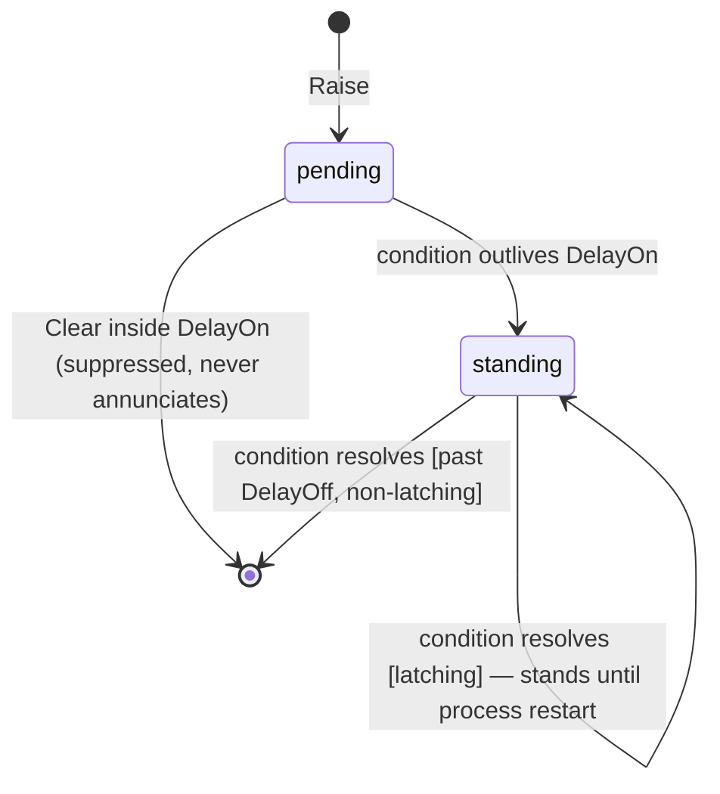

# Alarm Management

Status: implemented. The catalog lives in `backend/internal/alert/registry.go`
and the collector in `backend/internal/alert/collector.go`; the CLI surface
is `backend/cmd/gastrolog/cli/alerts.go` and the UI surface
`frontend/src/components/AlertPanel.tsx`. The catalog table below and
`registry.go` must agree.

The alarm system follows EEMUA 191 / ISA-18.2 / IEC 62682 principles, and
its purpose is **reduction**: few alarms, each one actionable.

## The governing test

> The most important thing about any kind of alarm is to ask: **does the
> operator need to do something?** If no, then it's not an alarm, and it
> just goes in the log.

This test gates everything else. It is applied **before** rate limits,
priorities, or suppression mechanics, to every existing and future
`Raise` site. A condition with no operator action is an **event** (a log
message) or a **metric** (health surface), never an alarm.

## Vocabulary

Three distinct concepts (defined in `docs/ubiquitous_language.md`):

| Term | Meaning | Surface |
|------|---------|---------|
| **Alarm** | A condition requiring operator action, with documented cause and response. An alarm is standing or it is not — there are no per-alarm operator states. | The alarm list (the System Alerts panel; `gastrolog alerts`) |
| **Event** | A record of something that happened; no action required. | The log stream (slog lines, captured by the self ingester, searchable like any other logs) |
| **Metric** | A measured quantity trending over time. | Health/stats surfaces (`NodeStats`) |

## Principles

1. **Actionability** — every alarm requires a response (the governing test).
2. **Rate** — steady-state target ~1 alarm per operator per 10 minutes,
   met by having FEW alarms — the razor and chattering suppression — not by
   measuring and managing a rate.
3. **Chattering suppression** — delay-on / delay-off timers and latching
   instead of raw raise/clear flapping.
4. **Consequence-based priority** — priority derives from a documented
   consequence × urgency assessment in the catalog, never from the call
   site.
5. **Standing-alarm management** — the list reflects live, unhandled
   conditions: the razor keeps it short and release-on-resolve keeps it
   live.
6. **State model** — an alarm is standing or it is not; see "State model".
7. **Response guidance** — each alarm type carries documented cause and
   operator action, surfaced in the UI and CLI.
8. **Separation** — alarms vs events vs metrics (vocabulary above).

**Prevention, not management.** The system keeps alarms few by prevention:
the razor (most conditions never become alarms), the static catalog
(priority is never chosen at a call site), chattering suppression (flapping
conditions never annunciate), and latching for software-fault tripwires.
Acknowledgment, shelving and alarm-rate (flood) monitoring are not
supported: they are management machinery for an alarm volume the razor
exists to prevent. If the standing list ever outruns an operator, the fix is
more razor — demote or prevent the offending conditions.

## Alarm catalog

Priority derivation: **consequence** (what is at risk if unhandled) ×
**urgency** (how fast the risk compounds). `Critical` = data loss in
progress or scheduled; `High` = durability/availability degraded, will
compound; `Low` = needs attention on a human timescale.

### Software faults are not process alarms

Three rows below are **software faults**, not alarms on this scale:
`orchestrator-lock-leak`, `wal-reclaim-anomaly`, `chunking-build-diverged`.
EEMUA 191 and ISA-18.2 treat instrument and system faults as a class apart
from process alarms, because a broken instrument is not a process condition
and does not belong on a consequence × urgency scale. A software defect is
the same shape.

The test that separates them: **an alarm's response fixes the condition; a
software fault's response is to report it.** Restarting a wedged node
recovers service — it does not address why the lock leaked. Nothing an
operator can do at 3am fixes a lock-discipline bug.

Consequences for the model:

- **No rubric priority.** "The software is broken" is not consequence ×
  urgency. Software faults carry no priority (`AlarmPriority` unspecified)
  and display as FAULT, outranking Critical.
- **Latched.** A software fault stands until the process restarts — there is
  no release path, and that is intentional: the response to a software
  fault is report + restart, and a fault that "went away" is still a fault.
  `orchestrator-lock-leak` additionally can never self-clear: a leaked hold
  is not observable releasing.

A `Raise` for a type ID missing from the catalog is itself a software
fault: the collector logs the defect and surfaces a FAULT alarm carrying
the raiser's detail (`unregisteredAlarmType`), so neither the condition nor
the defect is silent. `TestEveryRaisedAlarmTypeIsCataloged` walks the
source tree to keep every literal raise site cataloged.

**Multi-setpoint conditions are separate alarms, not one alarm that changes
colour.** Two setpoints on one measurement are two alarms, each with its own
priority and its own response — the standard's HI / HIHI pattern
(`*-approaching` / `*-low` at Low, `*-capped` / `*-exhausted` at High). This
keeps priority a static property of the type.

The ID column is the real type ID in code; `<…>` is the instance key.

| ID (pattern) | Source | Condition | Verdict | Priority | Operator action (response text) |
|---|---|---|---|---|---|
| `segmentation-writer:<vault>` | segmentation | Durable segment commit failed; working segment abandoned for crash recovery — **accepted records at risk** | **Alarm** | Critical | Free disk space or replace the volume on the named node; ingest acks are failing until resolved |
| `chunking-unplannable-segment:<vault>` | chunking | Segment on-disk indexes unreadable; records stay unchunked and head copies cannot be purged | **Alarm** | Critical | Check disk health and segment file integrity on the named node. If this vault's retention disposition is delete, these records are discarded when their retention expires — that loss is scheduled, not hypothetical, so act before then |
| `chunking-retention-giveup:<vault>` | chunking | Vault keeps releasing segments unchunked at its retention give-up bound — records age out of the registry before chunking references them, discarded without reaching a chunk while the planner runs (a lone island give-up is suppressed by the DelayOn; the STANDING flood is the alarm) | **Alarm** (DelayOn 2m) | Critical | Chunking will not chunk a segment until a second node also holds a copy of it, so this usually means copies are not reaching the vault's other home nodes. Check that those nodes are up and that replication is progressing. Lengthening the vault's retention window buys time but does not fix the cause. Clears once the vault seals a chunk again |
| `wal-reserve:<wal>` | storage | Raft WAL space reserve lost | **Alarm** | Critical | Free disk space now — without the reserve, a full volume crashes consensus on this node |
| `orchestrator-lock-leak` | orchestrator | Orchestrator lock held or write-stuck past 1min | **Software fault** (latched) | — | **This should never fire.** If it does, it is a lock-discipline defect, not an operating condition: capture the acquisition stack from this node's log and file it. Restarting the node is a workaround to recover service, not the response |
| `wal-reclaim-anomaly:<wal>` | storage | A Raft WAL segment's live-bytes counter and the index disagree in either direction — a segment nominated as drained the index still references, or a counter above zero for a segment the index does not reference; the segment is retained and reclamation halts on it | **Software fault** (latched) | — | **This should never fire.** If it does, the WAL's live-bytes accounting disagrees with its index: capture the alarm detail and this node's WAL log lines and file it. Restarting the node rebuilds the counters from replay and resumes reclamation, but that is a workaround, not the response |
| `chunking-build-diverged:<vault>` | chunking | A sealed chunk's copy on this node carries a digest other than the one its seal recorded; the copy is renamed aside with a `.divergent` suffix so it is neither served nor counted as a holder, and the node pulls the agreed copy from another home | **Software fault** (latched) | — | **This should never fire.** Every home builds a chunk from the same records and must produce the same bytes. Capture the alarm detail and this node's chunking log lines — they name the chunk and both digests — and file it. The agreed copy replaces the renamed one on its own; restarting the node clears the alarm but is not the response |
| `wal-unlink-error:<wal>` | storage | A reclaimed Raft WAL segment's file could not be removed; reclamation is oldest-first, so nothing sealed behind it reclaims until the removal succeeds. Non-latching: a later successful removal clears it | **Alarm** | High | Check permissions and filesystem health on the WAL directory on the named node. Reclamation retries the removal on every later pass; no restart needed |
| `seal-stranded:<chunk>` | vault-lifecycle | A chunk exhausted its seal-resume retry budget: neither writable nor durable-complete, so its records are unqueryable and no downstream stage will touch them | **Alarm** | High | Read the alarm detail for the vault and chunk, then check disk health and free space on the named node. Do not delete the chunk directory without review: its records have not reached a sealed chunk anywhere |
| `vault-announce-failing:<vault>` | vault-lifecycle | This node seals and uploads successfully but cannot commit the metadata announce, so the cluster's view of the vault drifts behind what is on this node's disk | **Alarm** | High | Read the alarm detail for the failing operation and error. Check this node's vault-ctl Raft group: whether it has a leader, whether this node is a member, and whether it is committing. Do not decommission this node while this stands — its chunks are not represented anywhere else |
| `chunking-build-blocked:<vault>` | chunking | Head-of-queue chunk blocked on segments no local holder can supply, or a manifest referenced a released segment | **Alarm** (DelayOn 2m) | High | Bring back a node that holds the named segments. If that node is gone for good, those records exist nowhere else — the alternative is to accept the gap |
| `chunking-underreplicated:<vault>` | chunking | Segments below the replication minimum ≥2min; planning gated | **Alarm** | High | Check that every node in this vault's placement is up and that replication is progressing. If the node that originated these segments is permanently lost, the records exist nowhere else |
| `chunking-glcb-corrupt:<vault>` | chunking | Sealed-chunk GLCB unreadable; renamed aside with a `.corrupt` suffix so it is not served | **Alarm** (DelayOn 5m) | High | This normally heals itself: the chunk is rebuilt from its source segments or re-pulled from another home. **Only act if it keeps standing**, which is what the delay-on is for — check disk health on this node, and whether the vault's other homes still hold good copies |
| `chunk-unreadable:<chunk>` | retention | Chunk unreadable during retention; backoff retry scheduled | **Alarm** (DelayOn 10m) | High | Retries automatically. Only actionable once retries stop resolving it: investigate disk health on this node |
| `vault-search-failing:<vault>` | query | Searches fail on this node because a chunk of the vault cannot be opened or read; every query touching the vault fails with it | **Alarm** | High | Run `validate` on the vault to name the chunk. Restore it from another holder if the file is missing or damaged; otherwise the detail names the read error. Clears on the next successful search over the vault |
| `chunk-suspect:<chunk>` | cloud-reconcile | Cloud-backed chunk 404s in the blob store; removed from the index after the grace period | **Alarm** | High | Check the blob store for the named chunk. After grace it leaves the index — restore it from a peer or accept the loss |
| `unknown-orphan:<vault>:<chunk>` | vault | Chunk on disk with records but not recognized by the FSM; preserved | **Alarm** | High | Decide restore vs delete for the named chunk. Do **not** delete manually without review — the cluster has no other copy |
| `cloud-store:<vault>` | cloud | Cloud store unreachable; uploads stopped | **Alarm** | High | Check cloud credentials/endpoint/network; sealed chunks accumulate locally until restored |
| `cloud-backfill-stuck:<chunk>` | cloud-health | Cloud-backfill upload for a sealed chunk keeps failing after a chunk-manager registration repair was attempted; not converging to cloud-backed on its own | **Alarm** (DelayOn 10m, same backoff schedule as `chunk-unreadable`) | High | Read the alarm detail for the last upload error. If the chunk's GLCB is missing on disk, restore it from a peer holder or accept the gap; otherwise check cloud store credentials/connectivity and disk health on the named node |
| `vault-leaderless:<vault>` | placement | Placements resolve to no leader beyond the self-healing window | **Alarm** (DelayOn 60s) | High | Fix vault placements / node storage configs; retention, rotation, target refresh stopped |
| `vault-underreplicated:<vault>` | placement | Working replicas below desired RF with no eligible `Live` node to backfill (members on soft-offline or disk-protected nodes are retained but do not count) | **Alarm** | High | Restore nodes or reduce RF; durability target unmet |
| `vault-storage-class-missing:<vault>` | placement | Selected node has no storage of the vault's required class; leader placement refused | **Alarm** | High | Add storage of the required class on the named node, or change the vault's storage class |
| `vault-no-eligible-node:<vault>` | placement | No currently-eligible node; existing placements retained | **Alarm** | High | Restore an eligible node, or relax the vault's storage requirements |
| `vault-soft-offline-leader:<vault>` | placement | Leader contact lost while node still Live, or leader on an Unreachable/Maintenance node; rotation gated | **Alarm** | High | Investigate the named leader node |
| `node-unreachable:<node>` | node-lifecycle | Peer node Unreachable past the alert threshold (measured from the FSM-replicated `StateSince`) | **Alarm** | High | Investigate or restart the node |
| `vault-init:<vault>` | orchestrator | Vault instance failed to construct from config | **Alarm** | High | Fix the named config error; the vault is not serving |
| `config-side-effect-failed:<entity>` | config-dispatch | A committed config mutation could not be applied to this node's orchestrator; this node's running state diverges from replicated config. Per-entity, node-scoped — retries on the next dispatch touching the entity and on startup reconcile | **Alarm** | High | Read the detail for the failing entity, operation and error. Resolve the named error on this node (disk, storage config, construction error); clears on the next successful apply |
| `pipeline-backlog-capped:<vault>` | storage | Backlog **at** budget — new records for this vault are REFUSED | **Alarm** | High | Check chunking throughput, raise the budget, or reduce the ingest rate. This vault is refusing records now; others are unaffected |
| `vault-max-size-capped:<vault>` | storage | Vault **at** its max-size refuse bound — new records REFUSED | **Alarm** | High | Raise the bound (set a larger max size on an attached retention policy) or shorten retention. This vault is refusing records now; others are unaffected |
| `vault-bound-capped:<vault>/age` \| `<vault>/count` | retention | A retention policy's max-age or max-chunks bound is still violated after retention swept and attempted to clear it — new records REFUSED. Only when the stating policy has `refuse` enabled explicitly (default off); a plain drain-only policy never refuses | **Alarm** | High | Read the detail for which bound and vault; the detail names the vault's disposition. On a route or transfer disposition, `retention-deferred` stands once the drain has deferred for consecutive sweeps and names why the sweep isn't clearing the bound — resolve that first. On the delete disposition retention never defers, so no other alarm accompanies this one: the chunks still past the bound crossed it after the sweep evaluated it, or their deletes failed to commit. A chunk whose delete is committed (a pending delete awaiting acks) no longer counts toward the bound. Either way: raise the bound, shorten it enough that draining keeps up, or leave/turn the policy's `refuse` flag off to accept drain-only |
| `retention-deferred:<vault>` | retention | Configured non-delete disposition (route fan-out or transfer) deferred ≥3 consecutive sweeps (the count at the call site is the condition definition) | **Alarm** | High | See detail for the cause and disposition: free space on the starved volume, drain/grow the destination or target vault, or — last resort, discards the records — set the vault's retention disposition to delete |
| `retention-unenforceable:<vault>` | retention | Vault has retention_rules configured, but every referenced retention policy resolves with no trigger (no maxAge, maxSize, or maxChunks set) — the vault's only drain never runs, so it grows until the volume's free-space thresholds (the storage's diskFreeWarn / diskFreeFloor) engage. There is no per-vault size default to catch this | **Alarm** | High | Read the alarm detail for which policies resolved with no trigger. Add a maxAge, maxSize, or maxChunks to at least one referenced policy — maxSize alone is enough to both bound and drain the vault regardless of `refuse` (which defaults off); add `refuse=true` to also refuse admission while over it. Do **not** remove the vault's retention_rules to silence this — detaching every policy leaves the vault with no drain at all, growing until the volume's free-space thresholds engage |
| `disk-space-exhausted:<storage>` | storage | Storage out of space — admission for every vault placed on it SUSPENDED | **Alarm** | High | Free space, add capacity, raise the storage's threshold, or shorten retention for the vaults placed on it |
| `node-disk-space-exhausted` | storage | Node volume out of space — ingest admission SUSPENDED on this node | **Alarm** | High | Free space, add capacity, or shorten retention. Retention and deletes keep running |
| `pipeline-backlog-approaching:<vault>` | storage | Backlog approaching budget; chunking not keeping pace | **Alarm** | Low | Check chunking throughput, raise the budget, or reduce the ingest rate — before records start being refused |
| `vault-max-size-approaching:<vault>` | storage | Vault at 90% of its max-size refuse bound | **Alarm** | Low | Raise the bound (set a larger max size on an attached retention policy) or shorten retention — before records start being refused |
| `disk-space-low:<storage>` | storage | Storage below its free-space warn band | **Alarm** | Low | Free space, add capacity, raise the storage's threshold, or shorten retention for the vaults placed on it |
| `node-disk-space-low` | storage | Node volume below its free-space warn band | **Alarm** | Low | Free space, add capacity, or shorten retention |
| `retention-rate:<vault>` | retention | Retention delete rate sustained above 10/s over a 30s window (product constants; the rate window at the call site is the condition definition and its hysteresis) | **Alarm** | Low | Review the vault's rotation and retention policy; a configuration this aggressive degrades throughput until corrected |
| **`vault-home-cannot-store:<vault>`** | placement | A vault home node is disk-protected; collection and builds paused there | **Verdict open** (raised as Alarm) | Low | Razor is unclear. When healthy replicas ≥ RF the text itself says replicas are "backfilled automatically" — handled, nothing waits on an operator. When healthy < RF, the action is "free space", which is already `disk-space-*`'s action on that node. What it uniquely adds is *which vault* is affected. Demote to a metric, or keep as the vault-scoped view of a node condition? Until the verdict lands it is cataloged as a Low alarm, because the code raises it and a raised type must be cataloged. Do not implement changes to it from this table |
| `ingester-not-running` | ingestion | Ingesters that should run on this node are not running | **Log** | — | Not an alarm: the convergence sweep re-dispatches every tick and failed runs retry with backoff — the system is already doing everything an operator could ask, and the actionable detail (build/start errors) is already in the log. An alarm whose response is "check the log" is a log. The sweep logs divergence once per state change (never per tick), captured by the self ingester |
| chanwatch saturation | chanwatch | Internal channel saturated past watermark | **Event** | — | Transition-edge logs |
| ingest-pressure | orchestrator | Ingest pipeline pressure elevated/critical; ingesters throttling | **Metric** | — | `NodeStats.ingest_pressure_level`. If ingestion is throttled the matter is already handled — the throttle *is* the response, so nothing waits on an operator. The gate's `OnChange` hook logs one line per level transition (hysteresis-bounded); sustained pressure is never logged per tick — the self ingester captures slog, so continuous logging would feed the pressure |
| `self-ingester-drops` | ingester/self | Capture channel overflowing; diagnostic records discarded | **Metric** | — | `NodeStats.self_ingester_drops_total`. Capacity tuning, not operator action. Never logged: a line about dropped logs feeds the channel dropping them |
| `raft-wal-latency` | statscollector | WAL append max over threshold | **Event** | — | Transition-edge logs + stats (`RaftWalAppendMaxMs`) |
| scheduler-stall | schedwatch | Runtime stalled past leader lease | **Event** | — | Log + counters |
| election-storm | statscollector | Elections over the last minute at or above threshold, counting only groups that already had a leader (a new group's initial leader election is not churn) | **Event** | — | Transition-edge logs + stats |

Every alarm type has a catalog entry in code carrying its response text;
the UI and CLI show it. Response text carries no tracker IDs and no internal
jargon (see **Alarm register** in `docs/ubiquitous_language.md`).

**The best answer to "what priority should this alarm be?" is sometimes
"make the condition impossible."** Reach for that before writing a catalog
entry: a row that says "tell the operator we lost their data" is a row that
should have said "don't." Retention does not destroy a chunk with zero
records routed: an unreadable cursor flags the chunk for backoff retry and
raises `chunk-unreadable:<chunk>`, and a missing vault instance retains the
chunk.

Partial fan-out — individual records failing to submit for non-terminal
reasons, dropped when the chunk is destroyed — is a **deliberate
tolerance**: one bad record must not strand a chunk forever. It is reported
with a count on a single warn line per chunk rather than a warn per record,
and whether a nonzero count deserves an alarm of its own is open.

## Alarm-type catalog in code

A static registry, one entry per alarm type (`internal/alert/registry.go`):

```go
type AlarmType struct {
    IDPrefix      string        // "vault-leaderless", "cloud-store", ... (full ID = IDPrefix[:instanceKey])
    Priority      Priority      // Critical | High | Low; zero for software faults
    Source        string
    Cause         string        // the condition in operator terms
    Response      string        // what the operator should do
    DelayOn       time.Duration // suppression: condition must persist this long
    DelayOff      time.Duration // condition must stay clear this long before auto-clear
    Latching      bool          // sticky: stands after the condition clears, until process restart
    SoftwareFault bool          // defect tripwire: outside the priority scale
}
```

Call sites raise and clear by type: `alerts.Raise(typeID, instanceKey,
detail)` and `alerts.Clear(typeID, instanceKey)`, through the single
`alert.Sink` interface. The collector looks up the type and stamps
priority, cause and response; call sites never choose a priority. There is
no informational priority — informational conditions are events by
definition — and no operator-defined alarm category: every alarm enters
through `Raise` with its catalog priority. `retention-rate`'s thresholds
(>10 deletes/sec over a 30s window) are product constants in the
orchestrator wiring, not operator configuration.

### Suppression semantics

DelayOn/DelayOff/Latching are enforced in the collector, driven by the
catalog entry — call sites raise and clear the raw condition and carry no
alarm timers of their own.

- **Lazy evaluation.** Suppression windows advance on every Raise/Clear
  touching an alarm and on every read (`Standing()`/`Count()`), against the
  collector's injectable clock. A condition raised once and never re-raised
  still activates when its DelayOn elapses — the next read surfaces it.
- **FirstSeen is condition start**, not activation time: the delay-on
  window suppresses annunciation, not the condition's history. An alarm
  annunciating after a 60s DelayOn appears with 60s of age.
- **DelayOff continuity.** A condition that clears and returns inside the
  delay-off window is the same occurrence: the alarm stays active
  continuously, FirstSeen preserved, no phantom re-occurrence.
- **Condition-definition durations are not suppression.** A duration that
  is part of the condition itself and measured from durable state stays at
  the call site: `chunking-underreplicated` ("below the minimum ≥2min") is
  a predicate over each gated segment's FSM `PublishedAt` — moving it onto
  DelayOn would false-alarm under sustained ingest, where *some* fresh
  segment is always briefly inside its replication window even though no
  individual segment is stuck. `node-unreachable`'s threshold measures the
  FSM-replicated `StateSince` the same way.
- **Latching is plain sticky.** A latched alarm whose condition clears
  remains standing until process restart — there is no release path.
- Suppression state is **per-node** (each node's collector), like the
  alarms themselves; the aggregation layer sees only annunciated alarms,
  so a condition flapping on one node cannot chatter cluster-wide.

## State model

An alarm is **standing or it is not** — there are no per-alarm operator
states. Alarms are state with suppression:

- **Alarms are state.** They stand while the condition holds and clear when
  it resolves. A cleared alarm is not retained ("it fired while you were
  away" is event-ness on a state surface); the log stream is the event
  record (see "Events are log messages").
- **No acknowledgment.** Acknowledgment records that an operator *knows*
  about a condition; it changes nothing about the condition. An alarm list
  that reflects live conditions IS the awareness surface.
- **No shelving.** With a short list, an operator who has judged a Low
  alarm tolerable reads past it; operator suppression is not worth its
  state, its cross-node fan-out, or its UI surface.
- **Restart resets everything.** Nothing persists across restart — no
  journal, no file I/O in the alert package. After a restart a re-detected
  condition is simply a standing alarm again. **Loud is safe**: the failure
  mode of forgetting state is an alarm that is *too visible*.



- **Release is unconditional.** A non-latching alarm whose condition
  resolves (past DelayOff, immediately for zero) releases, full stop.
- **Latched alarms stand until process restart.** The latching types are
  software-fault tripwires, and the response to a software fault is
  report + restart — the restart is what clears it.
- **EEMUA principles 5 & 6 are met by having FEW alarms**, not by managing
  many. The razor keeps the list short; release-on-resolve keeps it live;
  suppression keeps it quiet. This deviates from ISA-18.2's full model
  (acknowledge, shelve, return-to-normal-unacknowledged, and the associated
  re-annunciation states) as a considered product decision: those states
  manage operator attention in a control room drowning in annunciators;
  here the attention surface is the list itself, and the event history
  lives in the logs.

### Proto / API

`SystemAlert` carries exactly the alarm: `id`, `priority`, `source`,
`detail`, `first_seen` (condition start of the current occurrence),
`last_seen`, `cause`, `response`, `software_fault`. There are no alarm
lifecycle RPCs: nothing an operator does mutates an alarm.

### Cross-node semantics

Alarms are raised per node and aggregated via the PeerState broadcast
(`Standing()` → `NodeStats.alerts`), so the full attributed list is
readable from any node — `GetClusterStatus` serves the CLI and the panel
identically. There are no cross-node alarm mutations.

## Events are log messages

GastroLog is a log system that ingests its own logs: every lifecycle
transition and demoted diagnostic is a structured slog line, the self
ingester captures those lines into a vault, and the query engine searches
them there. The log pipeline **is** the event record; there is no parallel
event store. EEMUA 191's separation (principle 8) is satisfied that way:
alarms live in the collector, events live in the logs, metrics live in
NodeStats.

- **Every transition edge logs exactly one slog line from the collector**
  — annunciation (including zero-delay raises) and resolution (released or
  latched-standing; the message says which). A condition that dies inside
  its delay-on window logs **nothing** — logging it would reintroduce the
  chattering the window suppresses. A slog-capture test pins one line per
  edge.
- **Demoted diagnostics keep their transition-edge logs**: the stats
  collector's election-storm and WAL-latency hysteresis edges, the
  chanwatch cross/resolve pair, and the ingest pipeline pressure gate's
  `OnChange` hook (one line per level change, hysteresis-bounded). The
  pressure **level** itself and self-ingester-drops stay **metrics** —
  sustained pressure must never generate sustained logging on the very
  path that is under pressure. Anything the self ingester would capture
  because of pressure or volume must be a metric, never a log.
- **Durability is the log pipeline's**: events land in whatever vault the
  self ingester routes to and live under its retention.

## UI and CLI

- The System Alerts panel is a flat list of every standing alarm in the
  cluster, sorted by priority (software faults first) then age, each row
  attributed to the raising node. A row shows the detail and the catalog
  cause; the catalog response opens under "what to do". The header pill
  reflects the most severe standing alarm.
- Event history is not a page: events are log messages, searched like any
  other logs.
- CLI: `gastrolog alerts` (per-node attribution, `--node` filter,
  `-o json`) and a standing-alarm table in `cluster status` render the same
  per-node NodeStats aggregation the panel reads, over the local Unix socket
  with no auth — alarms stay readable from a bare shell when a suspended
  system writes no logs. The CLI's priority→display mapping is a single
  function (`alarmPriorityStr`); software faults render as FAULT, outranking
  Critical.
