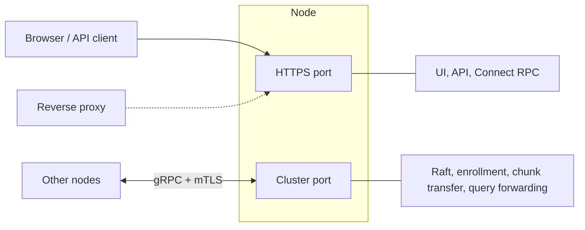
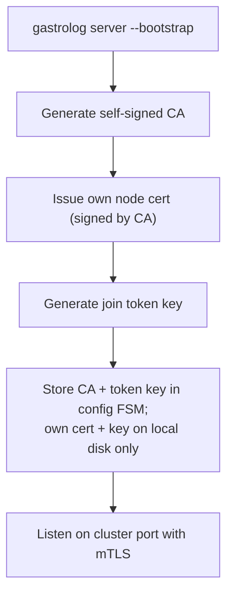
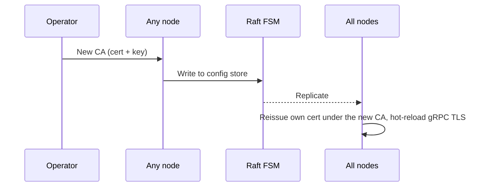
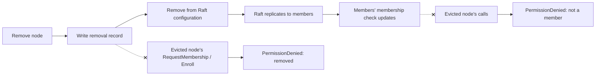

# Cluster Node Enrollment and Certificate Exchange

## Overview

Nodes join a cluster using a join token exchange over a dedicated
cluster port. After enrollment, each node holds its own certificate, signed
by the cluster CA, for mutual authentication. The CA is replicated via the
cluster-ctl FSM.

Prior art: K3s bootstrap model.

## Network Architecture

Two ports per node:



| Port | Protocol | Auth | Proxyable |
|------|----------|------|-----------|
| HTTPS | HTTP/2 + TLS | JWT / no-auth | Yes |
| Cluster | gRPC + mTLS | Per-node cert + membership | No (end-to-end TLS required) |

The cluster port runs a gRPC server with mTLS. Raft transport is
GastroLog's own `multiraft.Transport` (`backend/internal/multiraft`), which
carries every Raft group — cluster-ctl and each vault-ctl group — over the
cluster port; with TLS, each group gets its own inbound gRPC lane
(`cluster.Server.EnsureRaftGroupLane`). Additional gRPC services on the same
port handle inter-node operations such as chunk transfer, federated query
forwarding, and health checks.

## Cluster Bootstrap (First Node)

First node starts with `--bootstrap`. Generates:

1. **Cluster CA** — self-signed X.509 CA key pair
2. **Its own node cert** — signed by that CA, subject CN = its node ID,
   ExtKeyUsage: ServerAuth + ClientAuth
3. **Join token key** — a random 32-byte secret that join tokens are minted
   from (see Join Token Lifecycle)



The CA (cert and key) and the join token key are stored in the config FSM and
replicated to every node, so any member can enrol a joiner and no single node
has to be up for one to join. Node certificates are not replicated: each node
keeps its own key on its own disk.

The node begins listening on the cluster port with the certificate it just
issued itself.

## Node Enrollment

New node starts with `--join-token` and `--join-addr`. The address is any
member's cluster address, not the leader's:

```mermaid
sequenceDiagram
    participant N as New Node
    participant M as Member (any)
    participant L as Leader

    N->>M: TLS connect to cluster port
    Note over N,M: Node verifies the member's leaf chains to<br>the CA hash in the token (anti-MITM)
    N->>N: Generate key pair + CSR (key never leaves)
    N->>M: Enroll (token credential, CSR)
    M->>M: Verify token HMAC + expiry against the replicated key
    M->>M: Refuse if node_id is already in the configuration
    M->>M: Sign a cert naming node_id (CA from replicated state)
    M-->>N: CA cert, node cert
    N->>N: Load its cert, start cluster port gRPC with mTLS
    N->>M: RequestMembership (mTLS, with the new cert)
    alt member leads
        M->>M: Refuse a removed node_id; AddNonvoter
    else member does not lead
        M->>L: ForwardSetNodeSuffrage
        L->>L: Refuse a removed node_id; AddNonvoter
    end
    M-->>N: Membership granted
```

Enrollment is always node → member: the new node has nothing to listen with
before it receives its certificate, so the cluster cannot initiate.

Which member is irrelevant. Enrolment answers out of replicated state, which
every node holds, and the membership change is routed to the leader by the
member rather than by the joiner — the same forwarding every other
configuration change already uses. A joiner therefore never discovers, follows,
or is told about leadership, and no single node is the one that has to be up
for a join to succeed.

The two calls are deliberately separate. `Enroll` is authenticated by the token
alone, because the caller has no certificate yet. `RequestMembership` is
authenticated by mTLS with the certificate just issued, so reaching the
configuration takes more than a copy of the token.

The node ID on the request is a request. The member decides what the
certificate says, and refuses to name a node the configuration already has —
otherwise a token holder could be issued the identity of a current member —
or a node the cluster removed (see [Node Revocation](#node-revocation)). A
node that genuinely lost its disk is removed and comes back as a new node,
under a new node ID, rather than having its old identity re-issued.

## Admission

`RequestMembership` carries the node's ID and address and nothing else: the
node has no say in its suffrage. The leader decides, against the
configuration and the removal record:

| Requesting node | Outcome |
|-----------------|---------|
| Named in the removal record | Refused, `PermissionDenied`; the configuration does not change |
| Not in the configuration | Added as a nonvoter (learner) |
| A nonvoter in the configuration | Re-added at the requested address, still a nonvoter |
| A voter in the configuration | Re-added at the requested address, still a voter |

A vote is granted by the cluster-ctl learner promoter once the learner has
caught up, or by an operator's promotion — never by asking. A learner asking
again stays a learner.

The leader reads the removal record after a barrier, so its view includes
every removal committed before the request, including one committed under a
previous leader. Admission and removal are serialized on the leader, so a
request cannot read the record just before a removal writes it and then add
the node back just after the removal takes it out.

The member that serves `Enroll` checks the same record against its own,
possibly lagging, replicated state, so a removed node is normally refused a
certificate before it ever asks for membership; the leader's check is the one
that decides.

## Join Token Lifecycle

- No standing token. The cluster stores only the join token key; a token is
  minted on demand from it — by `gastrolog cluster join-token`
  (`CreateJoinToken`, answered by any node) or by the `/cluster/bootstrap-token`
  endpoint a joiner fetches at its own startup — and is not stored
- Format `<expiry-unix>.<hmac>:<hex sha256 of the CA cert DER>`. The credential
  half is an expiry and an HMAC over it under the token key, so nothing is
  stored per token and the expiry cannot be extended by editing it; the CA hash
  lets the joiner verify the member before it sends the credential
- TTL-limited: one hour by default (`tlsutil.DefaultJoinTokenTTL`), overridable
  with `--ttl`. A token is not single-use — it admits any number of joins until
  it expires
- Token is only used during enrollment — the node's own certificate,
  together with its membership, is the ongoing credential
- Enrollment runs only on a node's first boot. A restarting node resumes
  with its stored certificate even when the join address and token are
  still configured (containerized deployments pass both on every boot)
- A token source (`--bootstrap-token-url`) is contacted only when enrollment
  is about to run — when the node's home holds no loadable certificate. A
  restarting node never waits on it, so a whole-cluster restart does not
  depend on the token-serving node, whose HTTP listener opens only once its
  Raft group has quorum. Holding a certificate is the whole of what the token
  would have bought: a certificate the cluster CA did not sign gets no
  membership, and an unreadable certificate file stops the node rather than
  being treated as absent

## Certificate Properties

Each node holds its own certificate and its own private key. The key is
generated by the node that uses it and never leaves it.

| Property | Value |
|----------|-------|
| Issuer | Cluster CA (self-signed) |
| Subject | CN = the node's ID |
| ExtKeyUsage | ServerAuth, ClientAuth |
| Validity | Long-lived (e.g. 10 years), rotatable |

## What a Certificate Authorises

A valid signature is necessary and not sufficient. Every call on the cluster
port except `Enroll` requires a certificate, and every call except `Enroll`
and `RequestMembership` additionally requires that the node the certificate
names is in the Raft configuration this node holds.

`RequestMembership` is the single call made with a certificate from outside
the configuration, because it is the call that asks to be put in it. Passing
the certificate check buys it no more than [Admission](#admission) allows: a
learner's seat for a new node, and nothing for a removed one.

A node whose local configuration is empty admits any valid certificate. An
empty configuration means the membership is unknown rather than empty — a
node that has just started, or a joiner that has not replicated yet and whose
peers must be able to reach it to deliver the configuration at all.

Refusals that involve a removed identity are logged by the refusing node with
the identity presented: a `RequestMembership` from a removed node, and one
whose request names a different node than its certificate
(`requested_node_id`, `certificate_node_id`), are logged on the member that
received it; any other call from a node in the removal record is refused as
"removed from this cluster", with the `RemovedNodeRefusal` detail, and
logged once per node. A non-member that is
not in the removal record — a joiner reaching a peer that has not applied its
admission yet — is refused without a log line.

## Certificate Rotation

What rotates is the CA. A node answers a new CA by issuing itself a
certificate under it: a certificate signed by the previous CA would no longer
chain for peers that have already moved.



This is a single-phase swap and therefore disruptive: a node that reloads
before its peers presents a certificate they do not yet trust. A non-disruptive
CA rotation needs a two-phase rollout — distribute the new CA cert so every
node trusts both, then move issuance to it — which is not built.

## Node Revocation

Remove the node from the cluster. Its certificate stays cryptographically
valid and stops being accepted: peers check the node it names against their
own configuration, which no longer lists it.

Removal also writes the node's ID to the **removal record** in the config FSM,
before the configuration change, so there is no instant at which the node is
out of the configuration and free to ask back in. The record is replicated
like any other cluster-ctl state and survives restarts and snapshots. It is
what closes the one call a removed certificate can still make:
`RequestMembership` from a recorded ID is refused, as is `Enroll` naming it.



No certificate rotation, no CRL, no reissue of the rest of the cluster.

The record is permanent: a removed node ID never re-enters the cluster. To
bring the same machine back, start it from an empty home directory. It then
has a new node ID, enrolls with a join token like any new node, and is
admitted as a learner. A removal whose configuration change fails after the
record was written leaves the node in the configuration but unable to
re-address itself; retrying the removal completes it.

### The removed node's side

After the configuration change the leader tells the removed node
(`NotifyEviction`). The node takes that notice only from the leader it
follows, as the caller's certificate names it, and only while it knows its
membership; from any other member, from a node outside its configuration,
or while its configuration is empty, the notice is refused and logged.

A node that was down then learns it from the members that refuse its
calls: the refusal of a node in the removal record is a `PermissionDenied`
carrying a `RemovedNodeRefusal` detail that names the node. A refusal is a
claim, and a claim counts only when all of these hold:

- the detail names the node itself;
- it comes from the peer the node dialled, whose certificate names it;
- that peer is in the configuration the node holds, and not in the node's
  own removal record;
- the call was not the eviction notice — whoever answers that one is the
  node being removed.

No single claim ends a membership. The node ends it once a majority of the
other voters in its configuration have claimed it, each counted once; the
tally starts over whenever its configuration changes. A restarted removed
node dials every member it lists, and every genuine member refuses it, so it
gets there quickly: in a three-node cluster both others, in a two-node
cluster the one other. One member's word is never enough, because a removed
node keeps its certificate and still answers whatever dials it — a member
that has not yet seen the removal, or is cut off from the rest, still lists
and dials it — and because a single compromised member would otherwise take
out every node that dials it. A two-node cluster is the exception it cannot
cover: there, the one other voter is the majority.

A `RequestMembership` refused with the detail never counts on its own: the
node at the join address is only known to hold a certificate the cluster CA
signed, and a fresh home was never in a cluster to be removed from. Such a
refusal stops that start with an error-level log line and records nothing;
the next start asks again.

The notification is taken in even while the node is stopping: a graceful
stop waits for the call, so a removal that races a rolling restart is not
lost.

Either way the node shuts its member side down and records the removal in
its home, in the cluster-ctl Raft stable store beside its node identity, so
the two cannot be separated short of deleting both. It then serves only the
account of the removal (see the Removed state in
[node-lifecycle-design.md](node-lifecycle-design.md)): the full account —
reason, time and remedy — on its Unix socket and in its log, and on its TCP
listener, which authenticates nobody, only the probes and a bare "removed
from cluster". Every later start of that home finds the record before it
opens Raft, loads a certificate or contacts a peer, and serves the removal
again. The node keeps its certificate and its identity; neither buys it
anything.

A home that holds `cluster-tls.json` but no node identity — its raft
directory deleted, or only the identity store in it — is refused at start.
Minting a new identity there would pair it with a certificate naming the old
one, which no member admits. A home whose certificate names a different node
than its identity is refused the same way. Both are local refusals with an
operator-facing reason; the cluster's own checks above are what deny the
identity regardless of what the node runs.

Bringing the machine back as a new node takes an empty home and emptied
vault storage. Vault data directories are named by vault, not by node, so a
new node given a file storage at the old path would open the removed node's
chunk directories for any vault placed on it.

## Constraints and Trade-offs

- **The CA private key is on every node.** It has to be: enrolment is served
  by whichever member a joiner reaches, so every member must be able to issue.
  The consequence is explicit — this PKI cannot contain a compromised node,
  because a compromised node can mint any identity. What it does give is
  attribution (a certificate names one node), revocation (removal takes
  effect immediately, cluster-wide, with nothing to reissue, and the removed
  identity stays out), and a join token that buys one identity rather than
  the cluster's private key. A removed node keeps the copy of the CA key it
  replicated while it was a member, so it can still mint a certificate for a
  new node ID and enter under it as a learner; containing that takes
  rotating the CA (and the join-token key) after the removal.

- **No cluster → node enrollment.** No member can initiate a connection to a
  node that has no cert yet, so enrolment is always joiner-initiated.

- **Cluster port must be directly reachable** between nodes. Cannot
  sit behind a TLS-terminating reverse proxy (mTLS requires
  end-to-end TLS).

- The **HTTPS port remains independently configurable** and proxyable.
