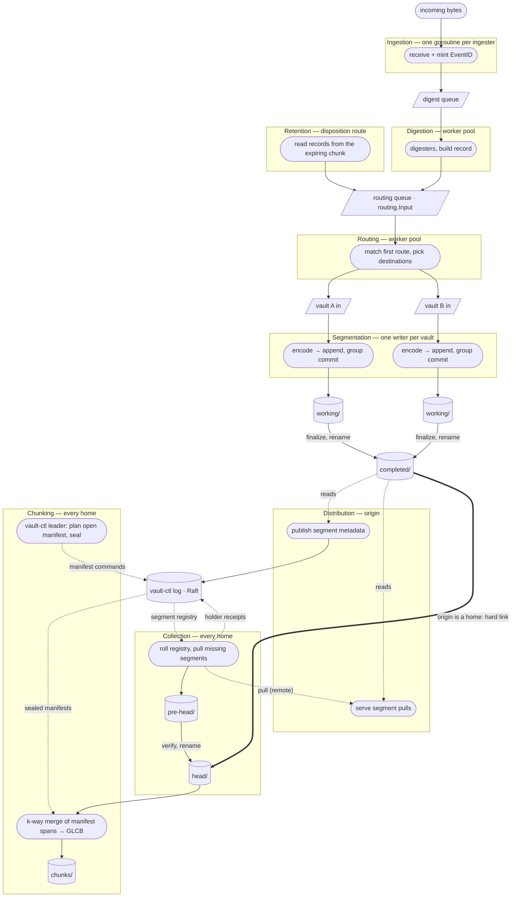

# V3 Pipeline

The write path every vault's records take, from the ingester that receives
them to the sealed GLCB chunk on each of the vault's homes:

```
Ingestion → Digestion ──┐
                        ├── Routing → Segmentation → Distribution → Collection → Chunking
Retention (route) ──────┘
```

Code lives in `backend/internal/pipeline/<phase>` (one package per phase), the
replicated state in `backend/internal/vaultraft/vaultctlfsm`, and the wiring in
`backend/internal/orchestrator` (`pipeline.go`, `pipeline_collection.go`,
`pipeline_root.go`) with the supervisor in
`backend/internal/orchestrator/pipeline`. Terms follow
[`ubiquitous_language.md`](../../ubiquitous_language.md) (section 9, Pipeline).
The chunk lifecycle on the vault-ctl FSM, GLCB catch-up and chunk tombstones
are described in
[`vault-control-plane-architecture.md`](../../vault-control-plane-architecture.md)
(section E); the GLCB byte layout in [`file_formats.md`](../../file_formats.md).

## Two halves

Ingestion through Segmentation is one in-process path on the node that
receives a record. A record is allocated once, at Digestion, and only its
pointer travels the bounded channels into the per-vault segmentation writer.
By the end of Segmentation the record is durable in a segment on that node —
its **origin** — so a matched record is durable as the direct consequence of
routing.

Distribution, Collection and Chunking are cross-node and driven by the
vault-ctl log and by pulls, not by the origin's channels. A slow or
unreachable home has simply not pulled yet: completed segments wait on the
origin's disk and never backpressure the writer. The only backpressure on
ingest is admission (disk floors, the vault's max-size bound, the backlog
budget) and the bounded channels in front of a slow local disk.



## Phases and managers

Each phase is a manager that owns the consumer side of one queue, does its
step, and hands off. The **orchestrator owns no phase**: the supervisor
(`orchestrator/pipeline.Supervisor`) wires the queues and starts and stops the
per-vault managers as placement brings vaults onto or off the node.

| Phase | Package | Runs | Work |
|-------|---------|------|------|
| Ingestion | `pipeline/ingestion` | per ingester assigned to the node | receive messages, mint EventIDs |
| Digestion | `pipeline/digestion` | one pool per node (4 workers) | run digesters, build the record |
| Routing | `pipeline/routing` | one pool per node (4 workers) | match the routing table, fan out to vault writers |
| Segmentation | `pipeline/segmentation` | per destination vault | write durable segments |
| Distribution | `pipeline/distribution` | per destination vault | publish segment metadata, serve pulls, promote locally |
| Collection | `pipeline/collection` | per vault the node is a home of | pull segments into `head/`, commit holder receipts |
| Chunking | `pipeline/chunking` | per vault the node is a home of | plan (leader), build, seal, release, purge |

Every node is an origin for every vault an enabled route targets, and for
every vault it is a home of (`reloadPipelineFromConfig`,
`buildPipelineVaultSpec`): a matched record always lands in a local segment,
whichever node received it. Collection runs only where a segment puller
exists (cluster mode); a single-node home chunks from its own `head/`.

Collection and Chunking never poll vault-ctl state on a timer. Vault-ctl
state changes only when Raft applies a command, so FSM apply callbacks
(segment publish, holder receipt, release, manifest open, ref added, seal)
wake a per-vault worker, and the callbacks only wake it: a pass run inline on
the apply goroutine would commit Raft entries from inside an apply and
deadlock the group. A worker also runs a catch-up pass when it starts.
Release purges and chunk tombstones additionally have a periodic backstop,
the vault catch-up sweep (`vaultCatchupSweepAll`, every 20 seconds on every
node).

## Records and EventID

Ingestion mints each record's **EventID** when it receives the message
(`ingestion.Minter`): `IngesterID`, `NodeID`, `IngestTS` (the mint time) and
`IngestSeq`, a per-ingester counter. EventID is the single key for identity,
dedup and order. `EventID.Compare` orders by `IngestTS`, then `NodeID`, then
`IngesterID`, then `IngestSeq` — a total order with no ties
(`record/eventid.go`).

Order is carried by the EventID, not by processing order, so Digestion and
Routing run as parallel pools and a segment's on-disk order is arbitrary.
Every reader that needs order uses the EventID index a segment carries. Dedup
means collapsing one EventID seen in two places; a client that sends the same
line twice gets two EventIDs and two records.

## Ingestion and digestion

An ingester emits `IngesterMessage`s; the ingestion manager mints the EventID
and puts an `IngestMessage` on the digest queue. A message may carry an
**ingestion ack** (`Ack chan<- error`): ack-gated ingesters set it and
release a message to their client only when it resolves; for every other
ingester it is nil.

Digestion runs the configured digesters on each message and builds an
immutable `record.Record`. A digester error ends the message: its ack, when
it has one, receives the error. Before a record enters routing the supervisor
consults the node's admission gate; a refusal is sent to the ack.

## Routing

The routing queue carries `routing.Input{Record, Source, Ack}`. Two producers
share it: the digestion output (`Source` from `IngestSource`) and retention
with disposition `route`, which re-enters already-built records read from the
expiring chunk (`SubmitRetentionRecord`, `Source` from `RetentionSource` with
the source vault and the retention reason). `Source` is never stored on the
record. During matching only, it is overlaid as the synthetic attributes
`_source` (`ingest` or `retention`), `_ingester`, `_vault` and `_reason`.

The routing table is swapped atomically on configuration changes and matched
lock-free. `MatchRoute` returns the first matching route in priority order;
the route's distribution mode picks the destinations (`fanout`: all of them;
`failover` and `round-robin`: the first destination, in configured or
rotating order, that admits the record). Each destination is checked against
the per-vault admission gate; a refusal rejects the whole record, because
delivering to the rest and dropping the refused vault's copy would be loss
for that vault. The router's only target concept is the vault — placement,
replication and storage class never enter matching.

A record that matches no route is an intentional, counted drop
(`Unmatched`). A matched record goes, as the same immutable pointer, to every
selected vault's segmentation queue. When the input carries an ack, routing
joins the per-vault commit results into it: the ack resolves nil only after
every destination has durably committed the record, and with the first error
otherwise.

## Segmentation

Each destination vault has one writer: an encode stage and an append stage
joined by a bounded channel. The append stage group-commits: it drains the
available inputs into a batch, writes the batch with one data write and one
header rewrite, fsyncs, and only then releases the batch's acks. A record is
**durable once that fsync returns**; the durability bar is that one on-disk
copy in the origin's segment. Copies on other nodes are the replication
climb that follows. `SegmentDisableFsync` (dev and load testing) drops the
fsync.

A working segment **completes** at 8 MiB or after 10 seconds since it was
opened, whichever comes first (`CompletePolicy`, defaults in
`orchestrator.go`). The age deadline is armed once the segment holds records,
so a segment whose input stops still completes; an empty segment never
completes. Completion finalizes the file — appends the EventID and SourceTS
index tails and sets the complete flag (`segment.File.Finalize`) — fsyncs it,
renames it from `working/` to `completed/`, and fsyncs the directory.

A writer whose commit fails nacks the batch, abandons the segment, and keeps
opening a fresh one on a backoff; until it has one it rejects ack-gated
inputs and counts the rest, and it raises an alarm. At registration, working
segments left by a previous process are reconciled to their last whole frame
and completed; empty ones are deleted.

## Distribution

On completion Distribution stages the segment's metadata — record count,
byte size, first and last `IngestTS`, segment checksum, origin node — and a
worker pool **publishes** it to the vault's completed-segment registry on the
vault-ctl FSM (`PublishCompletedSegment`), batching segments per vault. The
FSM treats an identical re-publish as a no-op, and a publish naming a
released segment is ignored. Failed publishes retry on a backoff.

When the origin is also a home of the vault, Distribution then **promotes**
the segment into `head/` as a hard link (`PromoteToHead`): the `completed/`
name stays so peers can keep pulling it until release. A filesystem that
refuses hard links gets a byte copy instead, written under a temporary name,
fsynced, and renamed in.

Distribution answers pull requests for segment bytes from `head/`,
`completed/` or `pre-head/` (`segmentPathForPull`). The origin never pushes:
the vault-ctl log carries intent, and bytes move only when a home pulls them.

## Collection

Every home of a vault collects every registered segment it does not yet hold,
skipping a segment that is already **superseded** — its records live in
chunks replicated to the quorum (see [Release and purge](#release-and-purge))
— so a node returning from an absence catches up through chunk replication
instead of chasing transport that is about to be purged
(`segmentLogReader.Roll`).

A pull tries the home's own copy first, then the origin, then every other
holder (`segmentPullClient`). Bytes land in `pre-head/` under a temporary
name; the segment is opened, checked against its own record and index
checksums and against the record checksum the origin published, and only then
renamed into `head/`. A copy that fails verification is discarded and its
source excluded for the rest of that pull, which moves on to the next holder;
the next pass offers every source again. Failed passes retry on the home's
own backoff — never waiting for a later publish, which a quiet vault may
never make.

At the end of each pass the home commits one batched **holder receipt**
(`AckSegmentHolder`) for the segments it now holds, growing each segment's
holder set. Receipts are the only evidence of residency.

## Chunking

### The open chunk manifest

Chunks are planned on the vault-ctl FSM by the chunking leader — the home
that is the vault-ctl leader — and built on every home. The **open chunk
manifest** is a replicated list of segment refs, each naming a slice of one
segment by **record number**: positions in the segment's EventID order,
0-based, inclusive (`OpenChunkSegmentRef{SegmentID, FirstRecordNumber,
LastRecordNumber, SliceBytes, …}`). Record numbers are never file offsets;
they resolve only through the segment's EventID index.

The planner (`chunking.Plan`, driven from `leader.go`) works over **eligible**
segments: registered, not yet fully consumed by earlier manifests, and held by
at least `min(2, placement size)` placed holders (`vaultctlfsm.HolderQuorum`).
The holder gate keeps a manifest from depending on a segment whose only copy
could disappear with one node; the cost is that chunking trails ingest by the
replication lag. Segments held below the quorum for long raise the
`chunking-underreplicated` alarm. Each step either rotates or appends one
slice:

- **Pick.** Continue the segment the manifest's last ref left partially
  consumed; otherwise take the eligible segment whose next unconsumed record
  has the smallest EventID.
- **Slice.** Walk that segment in EventID order from its resume position,
  adding records while the manifest stays within `MaxRecords` and `MaxBytes`
  (bytes are segment frame bytes). A slice cut by the budget leaves the rest
  of the segment for the next manifest.
- **Rotate.** Seal the manifest when it holds records and the cron job is due,
  when `MaxAge` has passed since the manifest's `OpenedAt` on the leader's
  clock, or when `MaxRecords` or `MaxBytes` is reached. An open manifest that
  stays empty past `MaxAge` (30 seconds without one) is discarded; an empty
  manifest is never sealed.

The thresholds come from the vault's rotation policy
(`manifestRotationPolicy`). Cron rotation is a scheduler job on every home
that only the leader acts on (`reconcileChunkCron`). The operator's seal
(`SealVault`, the vault's *Rotate* action) seals the open manifest ahead of
policy; only the chunking leader commits it or reports that nothing was open.
Any other node with the vault's vault-ctl group answers `Unavailable` (not the
chunking leader) rather than a zero its lagging FSM cannot vouch for
(`sealOpenManifest`, `nothingToSealOffHome`).

Sealing (`SealOpenChunkManifest`) moves the manifest onto the FIFO **seal
queue** and its chunk to `Sealing`, and the planner opens the next manifest,
so rotation never waits for a build.

### Build

Every home builds every chunk; no home receives another's build as the normal
path. The build (`BuildSealedChunk`) is a k-way merge over the manifest's
segment spans in EventID order, using each segment's EventID index, encoded
into a GLCB: EventIDs and raw bytes are copied verbatim, and attributes are
normalized into the chunk's string dictionary, a deterministic function of the
merged records. The same manifest over the same immutable segment bytes
therefore yields a byte-identical GLCB on every home. The file is written to a
temporary name and renamed into `chunks/<chunk-id>/data.glcb`, so a build
interrupted by a crash simply runs again.

A build needs every segment its manifest names. A home that lacks one does not
build — never a short chunk — and nudges Collection; the segments stay
collectable because nothing is released before the chunk is durable.

What a home builds is derived from FSM state and its own chunk root, never
from a local queue of events it happened to see: first, in seal order, every
**sealed-chunk manifest** (sealed, not cloud-backed) whose GLCB is missing
locally, then the seal-queue head. The FSM keeps a sealed-chunk manifest until
one of its segments is released or the chunk is deleted, so a home that lagged
the leader by any number of seals, or restarted, still builds each chunk while
its segments exist. A chunk whose segments are gone reaches the home through
the GLCB catch-up pull instead.

### Seal and the sealed digest

The leader builds the seal-queue head and commits `CmdSealChunk` with its
build's whole-blob digest (the GLCB TOC footer's `blobDigest`); the FSM
records it as the chunk's **sealed digest** (`ManifestEntry.Hash`), moves the
chunk to `Sealed`, and pops the queue. The sealed digest is write-once: a
later `CmdSealChunk` or `CmdUploadChunk` carrying a different digest is
refused. Followers build the same chunk without proposing.

Every GLCB that lands on a home — its own build, a peer pull, a
retention-transfer copy, or a copy it already holds when the seal applies — is
checked against the sealed digest before the home indexes it, serves it,
uploads it or commits a holder receipt (`AckChunkHolder`) for it. A copy whose
digest differs is a **divergent copy**: renamed to `data.glcb.divergent`,
forgotten by the chunk manager, never rebuilt locally, and replaced by the
agreed copy through GLCB catch-up; the `chunking-build-diverged` alarm stands
for the vault on that node. A pulled copy is promoted only when its bytes hash
to the sealed digest.

A GLCB already on the chunk's path when the build pass or restart recovery
reaches it is adopted only when it is a build of that manifest: its header
names the chunk, its record count and timestamp bounds match the manifest,
and, once sealed, it carries the sealed digest. Anything else is renamed to
`data.glcb.mismatched` and the chunk is built from its segments. Recovery
(`recover.go`) re-reads a finished build from its GLCB and proposes the seal
for a chunk whose build completed before `CmdSealChunk` applied.

A sealed chunk is complete on a home when its GLCB and its secondary indexes
(token, attribute, kv, json — built by the vault's index manager from the
GLCB) are both on disk; the timestamp indexes live inside the GLCB. Every
path that lands a GLCB indexes it (`onGLCBLanded`), and a home whose vault
instance arrives after its builds sweeps its GLCBs for missing indexes, since
any home can become the vault's leader and serve its searches.

## Release and purge

A segment's life ends in three steps, one per layer.

**Release** (vault-ctl). The chunking leader proposes `ReleaseSegments` for
segments that are no longer referenced by the open manifest or any queued
sealed manifest, are fully consumed, and either

- are **superseded**: every chunk containing their records is sealed and
  either held by `min(2, placement size)` placed holders or cloud-backed (the
  uploaded object is the durable copy; a home's GLCB of a cloud-backed chunk
  is a cached copy), or has since been deleted by retention; or
- are held by every placement member (`holdersCover`, the fast path).

Release therefore never waits on a dead home: the chunk reaches the quorum
among live homes, and the dead home catches up at the chunk level later. An
unresolved placement lookup fails these gates closed (`scanMayRelease`).

The one exception is the **retention give-up bound**: a segment that has sat
unreferenced in the registry longer than the vault's delete-disposition
retention TTL, measured from its `PublishedAt`, is released unchunked —
counted, logged, and alarmed as `chunking-retention-giveup` (`release.go`).

Release drops the registry entry and every sealed-chunk manifest that
references the segment, and leaves a **released-segment tombstone** stamped
with the release sequence. The tombstone is what stops a node that missed the
release, and still has the segment in `completed/`, from republishing it on
restart.

**Retire** (distribution). An origin drops its tracking of a released segment
so the stranded-segment rescan does not republish it.

**Purge** (disk). The release is the only trigger for deleting a segment's
staging copies; a segment the FSM has not released stays in `completed/`,
since a home may still need to pull it. Every node consumes the vault's
releases, home or not, and deletes the segment from `completed/`, `head/` and
`pre-head/` under every pipeline root it could hold it in
(`purgeReleased`). A release the node never saw as an event — applied while it
was down, before the vault registered, or carried in by a snapshot install —
is purged when the pipeline binds to the FSM, and by the released-segment
sweep (`sweepReleasedSegments`) on the vault catch-up cadence. Only the sweep
confirms: when every listing and delete succeeded it proposes
`ConfirmSegmentPurge` with the release sequence it read first, and the
vault-ctl leader's `PruneReleasedSegments` drops the tombstones every member of
its Raft configuration has confirmed. The tombstones are bounded by the
releases some member has not swept yet.

Separately, a home drops its own `head/` copy of a segment after building,
once the segment is unreferenced, consumed, and superseded or held by every
placement member (`mayPurgeHeadAfterBuild`).

## Backpressure

Because Chunking sits behind Collection and the seal chain, the pipeline
backlog — published, unreleased segments in the registry — is a normal
operating state under load, not a transient. The **backlog budget**
(`ClusterConfig` *Backlog Budget*, unreleased registry segment bytes per
vault) is the operating bound: at the budget, admission for that vault refuses
with `ErrVaultBacklogBudget`, a retryable nack, until chunking drains below
it. The measure is the replicated registry, so every node reaches the same
verdict. The disk guard's floors are the backstop behind it. While the disk
guard defers writes, chunking builds and collection pulls pause as well.

## Queries

A record becomes searchable once the leader adds its segment slice to the open
manifest. Search lists a vault's chunks from the vault-ctl manifest, including
`Active` and `Sealing` entries (`SearchChunkMetasForVault`). A chunk with a
local GLCB is read from it; otherwise its records are merged from the
manifest-listed segment spans in `head/` or `completed/`
(`OpenPipelineChunkCursor`), in the same EventID order and with the same
record positions the GLCB will have.

## Storage areas and the pipeline root

| Area | Holds |
|------|-------|
| `working/` | the segment Segmentation is appending; header provisional |
| `completed/` | completed segments: published, served for pulls, kept until release |
| `pre-head/` | in-flight pulls on a home; invisible to queries and chunking |
| `head/` | whole, verified, immutable segments on a home |
| `chunks/<chunk-id>/` | `data.glcb` and its secondary indexes |

All of a vault's areas on a node live under one **pipeline root**, because
promotion between areas is a rename or a hard link and both need one
filesystem (`pipelineRootFor`). On a node with a placement for the vault on a
file storage, the root is `<storage>/segments/<vault-id>`, so the vault's
storage class decides which volume its segments and GLCBs fill and that
storage's disk guard watches them. On a node that only originates segments for
the vault, the root is the node home's `segments/<vault-id>`.

A placement change can move the root — to another storage on the node, or
because the node became or stopped being a home. The next registration first
gathers the vault's files from every other candidate root into the new one
(`gatherPipelineRoot`): a home takes every area; an origin-only node takes
`working/` and `completed/`. Within one filesystem a file moves by rename;
across filesystems it is copied, synced and renamed into place before the old
copy is removed, so an interrupted gather leaves every file whole somewhere
and the next registration finishes it. A gather that cannot finish still
registers the vault on its new root and retries on the next reload.

## Segment file format

A segment is a header, the record frames, and — once completed — two index
tails. Conventions are those of [`file_formats.md`](../../file_formats.md):
little-endian integers, GLIDs as raw 16 bytes, timestamps as int64 Unix
nanoseconds (zero means unset), and the shared 4-byte header prefix with type
`S` (`format.TypeSegment`), version 1.

### Header (104 bytes)

| Offset | Size | Field | Meaning |
|--------|------|-------|---------|
| 0 | 4 | prefix | signature `0x69`, type `S`, version, flags (`0x01` = complete) |
| 4 | 16 | SegmentID | |
| 20 | 16 | VaultID | |
| 36 | 4 | RecordCount | records committed |
| 40 | 4 | DataEnd | offset where the last committed frame starts |
| 44 | 8 | FirstIngestTS | IngestTS of the first appended record |
| 52 | 8 | LastIngestTS | IngestTS of the last appended record |
| 60 | 4 | IndexOffset | start of the EventID index tail; 0 while working |
| 64 | 8 | SegmentChecksum | XXH64 of the record region `[104, IndexOffset)` |
| 72 | 4 | IndexChecksum | CRC32 (IEEE) of the EventID index tail |
| 76 | 8 | FirstSourceTS | earliest non-zero SourceTS |
| 84 | 8 | LastSourceTS | latest non-zero SourceTS |
| 92 | 4 | SourceIndexOffset | start of the SourceTS index tail |
| 96 | 4 | SourceIndexCount | SourceTS index entries |
| 100 | 4 | SourceIndexChecksum | CRC32 (IEEE) of the SourceTS index tail |

The header is rewritten after every committed batch, after the batch's data,
so it is never ahead of the data and the segment is inspectable at any point.
`DataEnd` is the recovery anchor: on reopen the frame at `DataEnd` is read,
any whole frames after it are picked up, and torn bytes after the last whole
frame are truncated. The segment checksum is a non-linear digest on purpose:
each frame already ends in a CRC32, and a CRC rolled over
`length ++ body ++ bodyCRC` cancels the body's contribution, leaving it blind
to same-length substitution.

### Record frames

Each record is `[frameLen:u32][body]`, appended in arrival order. The body:

| Field | Size |
|-------|------|
| EventID: IngesterID, NodeID, IngestTS, IngestSeq | 16 + 16 + 8 + 4 |
| SourceTS | 8 |
| WriteTS | 8 |
| attributes: `[count:u16]` then `[keyLen:u16][key][valLen:u16][val]` per attribute, keys sorted | variable |
| rawLen | 4 |
| raw | rawLen |
| CRC32 (IEEE) of the body before it | 4 |

The fixed-width EventID leads the body so the chunk build orders records by
reading only the length prefix and the EventID. Attributes are inline in
segments; they are normalized into the chunk's dictionary at build.

### Index tails

Completion appends, after the last frame:

- the **EventID index**: `RecordCount` entries of 48 bytes — the 44-byte
  EventID and the frame's file offset (u32) — sorted by EventID, then offset.
  Position *n* in this tail is record number *n*.
- the **SourceTS index**: one 12-byte entry (`SourceTS` int64, EventID-order
  position u32) per record with a non-zero SourceTS, sorted by SourceTS.

A segment opened with an index tail is checked for exact layout and all three
checksums; one without is reconciled from `DataEnd` and its record checksum
recomputed.
