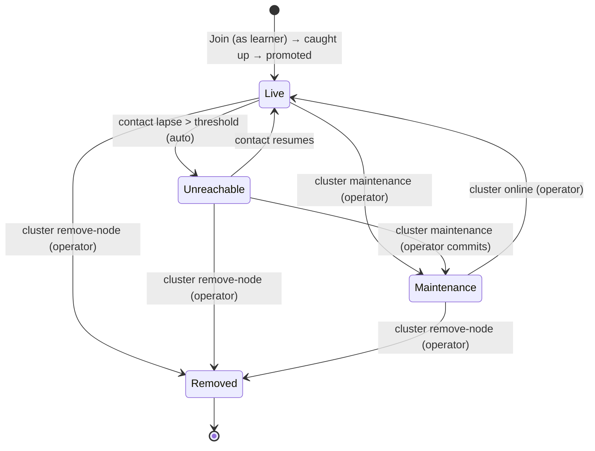

# Node Lifecycle: States, Transitions, and Learner Promotion

Status: implemented. Node states and transitions live on `NodeConfig` in
the cluster-ctl FSM (`backend/internal/system/storage.go`); the
`Unreachable` sweep and its event-driven auto-clear are in
`backend/internal/app/node_liveness.go`; the soft-offline placement guard
is in `backend/internal/app/placement.go`; learner promotion is in
`backend/internal/app/learner_promoter.go` with the cluster-ctl and
vault-ctl group adapters beside it.

## Context

A node's liveness is not binary. Transient absence — a Kubernetes rolling
restart, a network blip — must not be read as permanent removal: rotating a
vault's placement off an absent node orphans the chunks on its disk, and at
RF=1 that is the only copy. Kubernetes cannot tell GastroLog whether a
SIGTERM is a restart or a scale-down, so the cluster never removes a node
on its own; removal is always an operator action.

Node lifecycle therefore has explicit states with deliberate transitions.
**Cluster-detected absence** (`Unreachable`) and **operator-declared
absence** (`Maintenance`) are both *soft-offline*: the cluster considers the
node temporarily not fully participating, without considering it removed.
They share the placement-rotation gate and differ in how they are entered
and left. New nodes join as Raft learners and do not count toward quorum
until they have caught up.

## States



### Per-state semantics

**Live** — contact current; full participation. Placement may rotate to or
from this node. Vault-ctl Raft groups: voter (or learner during initial
join). Receives reads and writes when leader.

**Unreachable** (soft-offline; cluster-detected) — contact has lapsed past
the threshold (`GLOG_UNREACHABLE_THRESHOLD`, default 5 min). **Placement
does NOT rotate off this node.** Vault-ctl Raft groups: still a voter
(quorum maintained by the other voters). Reads addressed to the node fail
with a connection error. Entered automatically on contact lapse; cleared
automatically when contact resumes. Once the node has stayed Unreachable
longer than `GLOG_UNREACHABLE_ALERT_THRESHOLD` (default 5 min), every node
raises the High alarm `node-unreachable:<node>`.

**Maintenance** (soft-offline; operator-declared) — the operator has placed
the node in maintenance with `cluster maintenance <node>`. Cluster
behavior is identical to `Unreachable` for placement rotation and quorum
participation. The differences: entry is operator-initiated and sticky
(contact resumption does NOT clear it), exit requires `cluster online
<node>`, and it raises no alarm — the state is intentional. It captures
operator intent that persists across transient reachability changes, e.g.
host maintenance during which the cluster should ignore reachability flaps.

**Removed** — the operator removed the node with `cluster remove-node`.
Removal is refused when it would leave a vault without a copy, or below its
replication factor with no eligible node to re-place onto; `--force`
overrides both gates with explicit acknowledgement. The voter is removed
from cluster-ctl Raft and all vault-ctl groups and its NodeConfig is
deleted from the cluster-ctl FSM. `cluster demote-self` is the same removal
issued by a node against itself, for a preStop hook on a permanent
scale-down; it forces past the orphan gate and allows a removal that only
drops a vault below its replication factor, leaving re-placement to the
placement manager. The shipped Kubernetes manifest does not use it (see
"Relationship to the segment pipeline").

The removed node does not come back on its own. It learns of its removal
either from the leader, which tells it after the configuration change, or —
when it was down at the time — from the members that refuse its calls as
removed, once a majority of the other voters in its configuration have.
Either way it shuts its member side down in order — vaults, Raft groups,
cluster port, whatever point of startup it had reached — records the
removal beside its node identity in its home, and from then on serves only
the account of its removal: its log states it once at error level with the
remedy, and `cluster status` over its Unix socket reports it
(`GetClusterStatusResponse.removal`) with `cluster yield-leadership`
answering that nothing was transferred. Its TCP listener, which
authenticates nobody, keeps `/healthz` at 200 so the process is not
restarted and answers everything else, `/readyz` included, with a bare
"removed from cluster". Every later start of the same home comes up the
same way, without opening Raft or contacting a peer. It never mints a new
identity, never runs as a cluster of its own, and leaves its vault data
where it was. The way back is the operator's: start the machine from an
empty home and with its vault storage emptied, and it enrols as a new node
under a new node ID. A home that holds the cluster certificate but has lost
its node identity (its raft directory, or just the identity store in it) is
refused at start rather than given a new identity the certificate does not
name.

## Behavior gates by state

| Concern | Live | Unreachable | Maintenance | Removed |
|---|---|---|---|---|
| Placement may rotate TO | yes | no | no | no |
| Placement may rotate FROM | yes | **no (gate)** | **no (gate)** | n/a |
| New placements assigned | yes | no | no | no |
| Member counts toward replication factor | yes | no | no | n/a |
| Receives reads when leader | yes | yes (likely fails) | yes (may succeed if reachable) | n/a |
| Receives writes when leader | yes | yes (likely fails) | yes (may succeed if reachable) | n/a |
| Counts for Raft quorum | yes (if voter) | yes (if voter) | yes (if voter) | no |
| Contact tracked | yes | yes (lapsed) | yes | no |

The **"Placement may rotate FROM Unreachable/Maintenance = no"** rows are
the load-bearing gate for the RF=1 rolling-redeploy scenario and for
operator maintenance windows. Both soft-offline states share the same
placement-rotation gate; the placement guard in
[placement.go](../backend/internal/app/placement.go) treats them
identically.

The **"New placements assigned"** row is one predicate,
`acceptsNewPlacements` in [placement.go](../backend/internal/app/placement.go):
only a `Live` node takes a leader or follower placement it does not already
hold. The placement manager applies it (together with current contact)
when it picks a leader or a backfill follower, and the remove-node
RF-preservation gate applies the same predicate when it counts the spares a
removed node's placements could move to, so the gate never approves a
removal on the strength of a spare the placer will not use.

A placement member on a soft-offline node is retained but is not a working
replica (`countsTowardReplication`), so it does not count toward the
vault's replication factor: the placement manager backfills a follower onto
a `Live` node, and trims that surplus again once the node is back to `Live`
(the original member is kept). Contact loss on its own changes nothing
about an existing placement — a `Live` node whose contact has lapsed, as
during a pod restart, keeps every placement it holds and still counts —
because only the lifecycle state machine may read absence as more than
transient. A member is dropped only when its node has departed (no
`NodeConfig` and no contact) or its storage no longer matches the vault.

The reads/writes rows differ between `Unreachable` and `Maintenance` only in
expected outcome: an `Unreachable` node is by definition out of contact, so
reads to it almost always fail; a `Maintenance` node may be fully
functional and merely flagged "leave me alone". The cluster's *behavior* is
the same in both — try the node, observe success or failure.

## Storage layout for state

Node state lives on the `NodeConfig` cluster-ctl FSM record:

```go
type NodeConfig struct {
    ID         glid.GLID
    // ...
    State      NodeState // Live / Unreachable / Maintenance
    StateSince time.Time // when the current state was entered
}
```

`Removed` is not a stored state; it is the absence of the NodeConfig entry,
reached via `DeleteNode`. A record with no state set reads as `Live`
(`EffectiveState`).

## Transitions in detail

| From → To | Trigger | Mechanism |
|---|---|---|
| Live → Unreachable | `time.Since(peerState.LastSeen(node)) > threshold` | The cluster-ctl leader's `node-unreachable-sweep` scheduler job (every 30 s) proposes `SetNodeState{node, Unreachable}`, with `StateSince` set to the last-seen instant |
| Live → Maintenance | `cluster maintenance <node>` | `SetNodeState` RPC proposes `{node, Maintenance}` |
| Unreachable → Live | contact resumes | Event-driven, not the sweep: a peer's stats broadcast or PeerState's contact-resumed hook wakes `nodeLiveness.Run`, and the cluster-ctl leader proposes `{node, Live}` for every Unreachable node whose contact is current again |
| Unreachable → Maintenance | `cluster maintenance <node>` | Operator commits to the offline state; auto-clear on contact is replaced with sticky operator control |
| Maintenance → Live | `cluster online <node>` | Operator clears maintenance |
| any → Removed | `cluster remove-node <node>` | Refused when it would leave a vault without a copy or below its replication factor (unless `--force`); otherwise the voter is removed from cluster-ctl Raft and every vault-ctl group, the NodeConfig deleted, and the node told (or, if it is down, refused as removed when it calls in); it records the removal in its home and serves only that from then on |

The FSM apply validator (`ValidateNodeStateTransition`) rejects any other
transition; re-applying the current state is a no-op success. The sweep
never touches `Maintenance`, and never moves a node with no positive contact
evidence yet (zero `LastSeen`).

`peerState.LastSeen` is the most recent moment this node had positive
evidence a peer was alive: Raft contact on any group it shares with the
peer, or the arrival of the peer's stats broadcast, whichever is newer.
Raft contact is what keeps it fresh — the cluster-ctl group spans every
node, so the cluster-ctl leader, which runs the sweep, replicates to every
peer several times a second. The verdict is stored rather than derived at
read time because each node's `LastSeen` differs under an asymmetric
partition; placement guards on different nodes must read one replicated
value.

## Operator CLI surface

```
gastrolog cluster maintenance <node>     # Live | Unreachable → Maintenance
gastrolog cluster online <node>          # Maintenance → Live
gastrolog cluster remove-node <node>     # remove from the cluster (refused if it would orphan a vault or drop it below RF; --force overrides)
gastrolog cluster promote <node>         # cluster-ctl learner → voter
gastrolog cluster demote <node>          # cluster-ctl voter → nonvoter
gastrolog cluster yield-leadership       # hand off Raft leadership if this node holds it
gastrolog cluster demote-self            # remove this node (preStop hook for a permanent scale-down)
```

`Unreachable` is not something the operator invokes; the cluster detects
it, and the operator promotes it to `Maintenance` when sticky control is
wanted.

## API surface principles

The CLI verbs and status RPCs satisfy these properties:

- **Idempotent verbs.** `cluster maintenance <node>` twice has the same
  effect as once: the second call succeeds with no state change. Same for
  `cluster online` and `cluster promote`. A consumer that retries on
  transient failure is safe.
- **Watchable status.** Node state, `StateSince` and last-seen are on
  `ClusterNode`, served by `GetClusterStatus` and streamed by
  `WatchSystemStatus`; consumers react to transitions without polling.
- **Machine-readable output.** State-querying and state-changing CLI verbs
  honor `--output json` (`-o json`).
- **Stable state names.** `Live` / `Unreachable` / `Maintenance` are part of
  the API contract. Renaming or splitting them is a breaking change.
- **No hidden state.** Every operationally relevant fact about a node —
  current state, entry timestamp, last contact, suffrage — is on the status
  API. Transition history is the log stream: each transition is a slog line
  the self ingester captures.
- **Command/query separation.** Verbs that mutate state (`maintenance`,
  `online`) are distinct from verbs that read state (`status`, `inspect`);
  the mutating verbs report the resulting state, the querying verbs do not
  mutate.

## UI surface

The node lists show per-node state with a badge (`NodeStateBadge`,
`nodeStateView.ts`): `Unreachable` uses the warn tone (the cluster noticed a
problem), `Maintenance` the info tone (operator intent), each with its
duration from `StateSince`; `Live` shows no badge. Settings → Nodes offers
Promote, Demote and Remove. Entering and leaving `Maintenance` is a CLI verb
only (`cluster maintenance` / `cluster online`).

## Learner-based join

### Mechanism

New nodes are added as **non-voting learners** in two layers:

1. **Cluster-ctl Raft** — a joining node asks to be admitted as a nonvoter,
   and the cluster-ctl leader adds it with `AddNonvoter` (`resolveSuffrageOp`,
   `backend/internal/app/cluster.go`). A restarting voter rejoins as a
   voter.
2. **Every vault-ctl Raft group** — `RefreshVaultCtlMembers` hands the
   cluster's nodes to the vault-ctl leader manager, and on each group's
   leader `vaultCtlLeaderManager.reconcile`
   ([`vault_ctl_leader_manager.go`](../backend/internal/orchestrator/vault_ctl_leader_manager.go))
   adds a node that is not yet in the group with `AddNonvoter`.

The new node receives replicated state via Raft log replication (and
snapshots if far behind). It does not count toward quorum while a learner.

### Promotion: per-group, applied-index match

Promotion is event-driven and runs per group **on the group's leader**
(`learnerPromoter`). A learner's applied index reaches the leader only
through the learner's NodeStats broadcast — hashicorp/raft exposes no
per-peer match index — so each broadcast, and each leadership gain,
triggers one evaluation pass over the groups this node leads; there is no
periodic sweep. The leader promotes a learner with `AddVoter` once the
learner's last broadcast applied index is within the group's catch-up
tolerance of the leader's applied index: zero entries for cluster-ctl, 100
for a vault-ctl group (an active group commits faster than the broadcast
interval). A learner with no broadcast evidence yet is never promoted. Each
group promotes at most one learner per pass, because hashicorp/raft commits
configuration changes one at a time. Cluster-ctl and vault-ctl use the same
evaluator.

**Why per-group:** vault-ctl groups are independent. A learner caught up in
vault A is promoted there while still catching up on vault B. Convergence is
incremental.

**Why applied index (not log index):** "has applied what the leader has
applied" is the strongest statement available before counting toward
quorum. Log-index thresholds admit learners that have replicated entries
but not yet applied them, and vault-ctl groups carry FSM-sensitive chunk
lifecycle commands.

### Failure modes

- **Learner falls behind faster than it catches up:** it stays a learner;
  the promoter logs the lag at debug level, and the node's suffrage
  (`NONVOTER` / `STAGING`) shows in `cluster status`. The operator decides
  whether to wait or remove the node.
- **Snapshot install in progress:** the learner's broadcast applied index
  does not reach the leader's until the snapshot has been installed and
  applied, so it is not promoted before then.
- **Operator force-promotion:** `gastrolog cluster promote <node>` promotes a
  node to voter in cluster-ctl Raft, for when the operator knows the learner
  is caught up. There is no operator verb for promotion in vault-ctl groups.

### Composition with the soft-offline states

Promotion reads only applied-index evidence, not the node's lifecycle
state. A learner out of contact sends no broadcasts, so its last reported
index falls behind and it is not promoted until it reports again. A learner
in `Maintenance` that is reachable and caught up is promoted like any other.

## Relationship to the segment pipeline

Records become segments on the receiving node, are distributed to every
home of the vault, and every home builds its own chunks. Two pieces of this
design meet that write path:

- **The placement-rotation gate on soft-offline states.** The placement
  manager keeps a vault's leader and follower placements on a node that is
  `Unreachable` or `Maintenance` — or whose contact has lapsed while it is
  still `Live` — and raises `vault-soft-offline-leader` for a leader instead
  of rotating ([placement.go](../backend/internal/app/placement.go)). A
  follower restarting in a rolling restart keeps its placement, and its node
  keeps its vault instance. This gate is what keeps a transiently absent
  node's placement, and so its chunks, in place at RF=1.
- **The Kubernetes preStop hook** (`deploy/k8s.yml`) only yields Raft
  leadership (`cluster yield-leadership`); the node stays in the voter set
  across the restart. There is no leader-only unsealed state to flush before
  SIGTERM: every home holds the vault's segments and builds its own chunks.
  Permanent removal is the operator running `cluster remove-node`.
