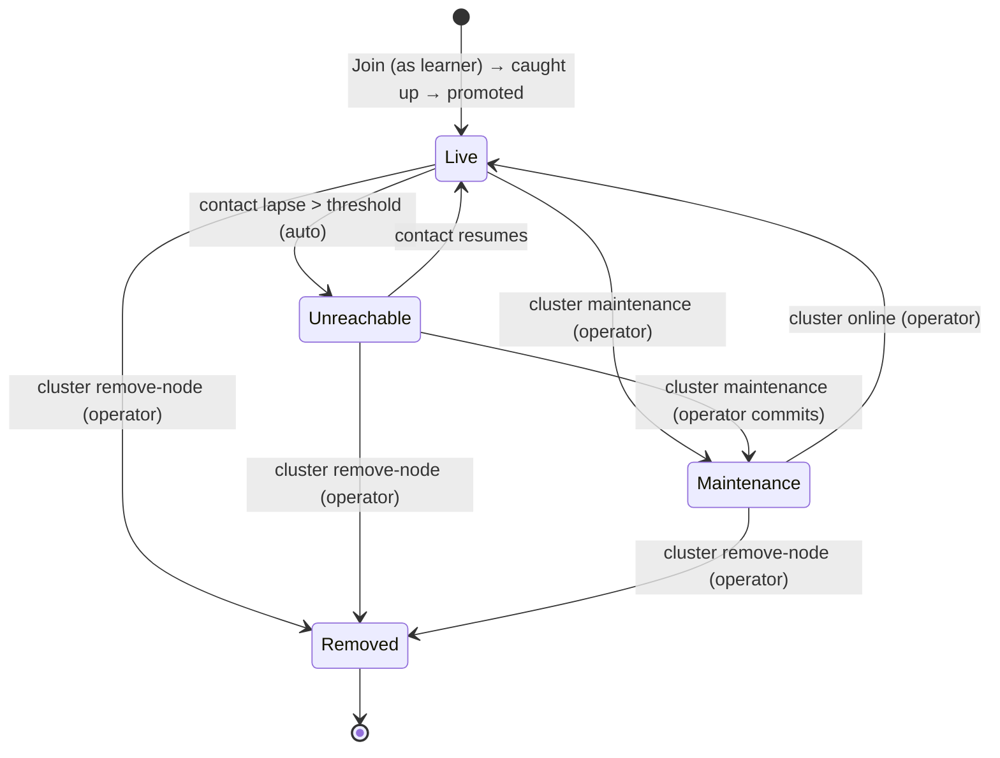

# Node Lifecycle: States, Transitions, and Learner Promotion

This document defines cluster node lifecycle and the learner-based join model. The node states and transitions, the `Unreachable` liveness sweep with event-driven auto-clear, the soft-offline placement guard, the operator CLI verbs, and learner-based join with event-driven promoters for cluster-ctl and every vault-ctl group are built.

## Context

The current node-lifecycle treats node liveness as binary: a node is either in `LivePeers` (Raft contact current within ~4s) or it is not. Every cluster decision — placement rotation, peer routing, decommission — derives from this single bit. The recent wave of fixes (gastrolog-2yeie series) hardened the *membership* layer but did not introduce gradations between "live" and "decommissioned." That gap is what allows transient absence (k8s rolling restart) to be misclassified as permanent removal, triggering placement rotation that orphans chunks on the absent node's disk.

This design introduces explicit node states with deliberate transitions, separates **cluster-detected absence** (`Unreachable`) from **operator-declared absence** (`Maintenance`) — both of which share the *soft-offline* property of "do not rotate placement off this node" — and folds in a learner-based join model so new nodes do not count toward Raft quorum until they are caught up.

The category "soft-offline" describes any state where the cluster considers the node temporarily not-fully-participating without considering it removed. Two concrete states fall in this category: `Unreachable` (cluster's automatic detection) and `Maintenance` (operator's deliberate declaration). They share the placement-rotation gate but differ in their entry/exit semantics and operator UX.

The record write path is the segment pipeline; how this design meets it is described in "Relationship to the segment pipeline" below.

## States



### Per-state semantics

**Live** — heartbeats current; full participation. Placement may rotate to or from this node. Vault-ctl Raft groups: voter (or learner during initial join). Receives reads and writes when leader.

**Unreachable** (soft-offline; cluster-detected) — contact has lapsed past the threshold (`GLOG_UNREACHABLE_THRESHOLD`, default 5 min). **Placement does NOT rotate off this node.** Vault-ctl Raft groups: still a voter (unreachable; quorum maintained by other voters). Reads addressed to this node fail with connection error (no change to current read routing). Auto-trigger entry: contact lapse exceeds the threshold. Auto-clear: contact resumes. A warning alarm fires once the node has stayed Unreachable longer than the alert threshold (`GLOG_UNREACHABLE_ALERT_THRESHOLD`, default 5 min); alert tone is "noticed a problem" — operator may want to act.

**Maintenance** (soft-offline; operator-declared) — operator has explicitly placed this node in maintenance mode via `cluster maintenance <node>`. Cluster behavior identical to `Unreachable` for placement-rotation and quorum participation. The differences: entry is operator-initiated and sticky (contact resumption does NOT auto-clear), exit requires explicit `cluster online <node>`, and alerts are informational rather than warning ("this is intentional"). The state captures operator intent that may persist across transient reachability changes — e.g., the operator is preparing the underlying host for kernel maintenance and wants the cluster to ignore brief reachability flaps during the window.

**Removed** — the operator removed the node with `cluster remove-node`, which refuses a removal that would leave a vault without a copy or below its replication factor. Voter removed from cluster-ctl Raft and all vault-ctl groups; NodeConfig deleted from cluster-ctl FSM. Node is no longer addressable. Any files remaining on retained PVCs are orphaned and handled by the orphaned-PVC sweep (separate issue).

## Behavior gates by state

| Concern | Live | Unreachable | Maintenance | Removed |
|---|---|---|---|---|
| Placement may rotate TO | yes | no | no | no |
| Placement may rotate FROM | yes | **no (gate)** | **no (gate)** | n/a |
| New placements assigned | yes | no | no | no |
| Receives reads when leader | yes | yes (likely fails) | yes (may succeed if reachable) | n/a |
| Receives writes when leader | yes | yes (likely fails) | yes (may succeed if reachable) | n/a |
| Counts for Raft quorum | yes (if voter) | yes (if voter) | yes (if voter) | no |
| Heartbeat tracked | yes | yes (lapsed) | yes | no |

The **"Placement may rotate FROM Unreachable/Maintenance = no"** rows are the load-bearing gate for the RF=1 rolling-redeploy scenario and for operator maintenance windows. Both soft-offline states share the same placement-rotation gate; the placement guard in [placement.go](backend/internal/app/placement.go) treats them identically.

The **"New placements assigned"** row is one predicate, `acceptsNewPlacements` in [placement.go](backend/internal/app/placement.go): only a `Live` node takes a leader or follower placement it does not already hold. The placement manager applies it (together with a current heartbeat) when it picks a leader or a backfill follower, and the remove-node RF-preservation gate applies the same predicate when it counts the spares a removed node's placements could move to, so the gate never approves a removal on the strength of a spare the placer will not use.

A placement member on a soft-offline node is retained but is not a working replica, so it does not count toward the vault's replication factor: the placement manager backfills a follower onto a `Live` node, and trims that surplus again once the node is back to `Live` (the original member is kept). Heartbeat liveness on its own changes nothing about an existing placement — a `Live` node whose heartbeat has lapsed, as during a pod restart, keeps every placement it holds and still counts — because only the lifecycle state machine may read absence as more than transient. A member is dropped only when its node has departed (no `NodeConfig` and no heartbeat) or its storage no longer matches the vault.

The reads/writes row differs slightly between `Unreachable` and `Maintenance` only in expected outcome: an `Unreachable` node is by definition out of contact, so reads to it will almost always fail; a `Maintenance` node may or may not be reachable depending on what the operator is doing (it may be fully functional and just flagged as "leave me alone"). The cluster's *behavior* is the same in both — try the node, observe success or failure — but the *probability of success* differs.

## Storage layout for state

Node state lives on the existing `NodeConfig` system-FSM record per node. Schema addition:

```go
type NodeConfig struct {
    ID         glid.GLID
    Address    string
    // ... existing fields ...

    State      NodeState  // NEW: Live / Unreachable / Maintenance
    StateSince time.Time  // NEW: when the current state was entered
}
```

`Removed` is not a stored state; it is the absence of the NodeConfig entry, reached via `DeleteNode`.

## Transitions in detail

| From → To | Trigger | Mechanism |
|---|---|---|
| Live → Unreachable | `time.Since(peerState.LastSeen(node)) > unreachableThreshold` | Leader-side sweep on a low-frequency tick (e.g. 30s) proposes `CmdSetNodeState{node, Unreachable}` |
| Live → Maintenance | `cluster maintenance <node>` CLI | RPC proposes `CmdSetNodeState{node, Maintenance}` |
| Unreachable → Live | contact resumes | Event-driven, not the sweep: a peer's stats broadcast or PeerState's contact-resumed hook wakes `nodeLiveness.Run` (`backend/internal/app/node_liveness.go`), and the cluster-ctl leader proposes `CmdSetNodeState{node, Live}` for every Unreachable node whose contact is current again |
| Unreachable → Maintenance | `cluster maintenance <node>` CLI | Operator commits to the offline state; auto-restore-on-contact behavior is replaced with sticky operator control |
| Maintenance → Live | `cluster online <node>` CLI | Operator clears maintenance |
| any → Removed | `cluster remove-node <node>` CLI | Refused when it would leave a vault without a copy or below its replication factor; otherwise the voter is removed from cluster-ctl Raft and every vault-ctl group and the NodeConfig deleted |

`peerState.LastSeen` is the most recent moment this node had positive evidence a peer was alive: Raft contact on any group it shares with the peer, or the arrival of the peer's stats broadcast, whichever is newer. Raft contact is what makes it fresh — the cluster-ctl group spans every node, so the cluster-ctl leader, which is the node that runs the liveness sweep, is replicating to every peer several times a second.

## Operator CLI surface

```
gastrolog cluster maintenance <node>     # Live | Unreachable → Maintenance
gastrolog cluster online <node>          # Maintenance → Live
gastrolog cluster remove-node <node>     # remove from the cluster (refused if it would orphan a vault or drop it below RF)
```

Cluster-detected soft-offline (`Unreachable`) is not something the operator manually invokes; the cluster auto-detects it via contact lapse, and the operator promotes it to `Maintenance` via `cluster maintenance` if sticky operator control is desired.

## API surface principles

The CLI verbs and status RPCs above must satisfy these properties:

- **Idempotent verbs.** Calling `cluster maintenance <node>` twice has the same effect as calling it once: the second call returns success with no state change, not an error. Same for `cluster online` and `cluster promote`. A consumer that retries on transient failure must be safe to do so.
- **Watchable status.** Node states and per-node metadata (state, `StateSince`, last-seen, etc.) are accessible via a server-stream RPC, not just point-in-time queries. Consumers can react to state transitions without polling.
- **Machine-readable output.** Every state-querying CLI verb supports `--output json` (or equivalent structured output) for parseable consumption.
- **Stable state names.** `Live` / `Unreachable` / `Maintenance` are part of the API contract once released. Renaming or splitting them post-release is a breaking change.
- **No hidden state.** Every operationally-relevant fact about a node (current state, entry timestamp, transition history, alert-relevant counters) is observable via the status API. Decisions made by external systems cannot rely on state that the API doesn't surface.
- **Command/query separation.** Verbs that mutate state (`maintenance`, `online`) are distinct from verbs that read state (`status`, `inspect`). Mutating verbs return the new state; querying verbs do not mutate.

These are good properties for any cluster CLI regardless of whether an external orchestrator (Kubernetes operator, deployment automation, runbook script) ever consumes them. Designing for them up front avoids retrofitting if an external controller is added later.

## UI surface

Cluster overview shows per-node state with color/icon coding. The two soft-offline states are visually distinguishable: `Unreachable` uses a warning tone (cluster noticed a problem), `Maintenance` uses an informational tone (operator action). Duration is shown for both. Alerts trigger with operator-action suggestions when `Unreachable` duration exceeds an operator-tuned threshold; `Maintenance` alerts are silent or low-priority.

## Learner-based join

### Mechanism

New nodes joining via `JoinCluster` are added as **non-voting learners** in two layers:

1. **Cluster-ctl Raft** — a joining node asks to be admitted as a nonvoter, and the cluster-ctl leader adds it with `AddNonvoter` (`resolveSuffrageOp`, `backend/internal/app/cluster.go`). A restarting voter rejoins as a voter.
2. **Every vault-ctl Raft group** — `RefreshVaultCtlMembers` hands the cluster's nodes to the vault-ctl leader manager, and on each group's leader `vaultCtlLeaderManager.reconcile` ([`vault_ctl_leader_manager.go`](backend/internal/orchestrator/vault_ctl_leader_manager.go)) adds a node that is not yet in the group with `AddNonvoter`.

The new node receives replicated state via Raft log replication (and snapshots if far behind). It does NOT count toward quorum during this phase.

### Promotion: per-group, FSM apply-index match

Promotion is event-driven and runs per group **on the group's leader** (`learnerPromoter`, `backend/internal/app/learner_promoter.go`). A learner's applied index reaches the leader only through the learner's stats broadcast, so each broadcast — and each leadership gain — triggers one evaluation pass over the groups this node leads; there is no periodic sweep. The leader promotes a learner with `AddVoter` once the learner's last broadcast applied index is within the group's catch-up tolerance of the leader's applied index: zero entries for cluster-ctl, 100 for a vault-ctl group (an active group commits faster than the broadcast interval). Cluster-ctl Raft uses the same evaluator.

**Why per-group:** vault-ctl groups are independent. A learner caught up in vault A can be promoted there even while still catching up on vault B. Convergence is incremental.

**Why apply-index match (not log-index threshold):** the most rigorous criterion. "Has applied every command the leader has applied" is the strongest correctness statement before counting toward quorum. Log-index thresholds admit learners that have replicated entries but not yet applied them — fine for some systems, but vault-ctl groups have FSM-sensitive operations (chunk lifecycle commands) where apply-index match matters.

**Stability window:** one Raft heartbeat timeout (default 2s). Prevents flapping if the learner momentarily catches up then falls behind.

### Failure modes

- **Learner falls behind faster than catches up:** stays a learner, alert fires ("node-X is a learner in 3/12 vault-ctl groups; investigate"). Operator decides whether to wait or remove.
- **Snapshot install in progress:** sweep does not propose promotion until snapshot installation completes and applies.
- **Operator force-promotion:** `gastrolog cluster promote <node>` promotes a node to voter in cluster-ctl Raft, as an escape hatch when the operator knows the learner is functionally caught up. There is no operator verb for promoting in vault-ctl groups.

### Composition with the soft-offline states

Learners can become `Unreachable` (contact lapsed) or be placed in `Maintenance` (operator) the same way voters can. A learner in either soft-offline state is not promoted while in that state. State transition back to `Live` unlocks promotion on the next sweep tick.

## Relationship to the segment pipeline

Records become segments on the receiving node, are distributed to every home of the vault, and every home builds its own chunks. Two pieces of this design meet that write path:

- **The placement-rotation gate on soft-offline states.** The placement manager keeps a vault's leader and follower placements on a node that is `Unreachable` or `Maintenance` — or whose heartbeat is lost while it is still `Live` — and raises a soft-offline alarm for a leader instead of rotating ([placement.go](backend/internal/app/placement.go)). A follower restarting in a rolling restart therefore keeps its placement, and its node keeps its vault instance. There is no separate Receiving/Holding split of the placement; this gate is what keeps a transiently absent node's placement, and so its chunks, in place at RF=1.
- **The Kubernetes preStop hook** only yields Raft leadership (`cluster yield-leadership`). There is no leader-only unsealed state to flush before SIGTERM: every home holds the vault's segments and builds its own chunks.

The lifecycle states, learner-based join, soft-offline category (`Unreachable` + `Maintenance`), API surface principles, and operator CLI verbs are independent of the write path.

## Out of scope (deferred to implementation issues)

- Specific threshold values (5 min default for `Unreachable` auto-trigger is provisional; tune operationally)
- Exact FSM command proto schemas
- Migration semantics for existing clusters (existing voters likely stay voters; only new joiners become learners — but the transition path needs an explicit issue)
- UI mockups
- Alert text and severity
- Interaction with the decommission orphan-refusal gate (separate implementation issue from this design)

## Acceptance for this design

This document is sufficient to open the following implementation issues:

1. Node state machine — `NodeConfig` schema addition + `CmdSetNodeState` + transition validators (Live / Unreachable / Maintenance, with Removed as the absence of the NodeConfig)
2. State-driven placement guard in [placement.go](backend/internal/app/placement.go) — gates on both soft-offline states identically
3. `Unreachable` auto-trigger sweep (leader-side) + contact-resume auto-clear
4. Operator CLI verbs for state transitions (`maintenance`, `online`, `remove-node`)
5. UI surface for per-node state visibility with the warning/informational tone distinction
6. Learner-based join: `AddNonvoter` path in [cluster/join.go](backend/internal/cluster/join.go)
7. Per-group learner promoter
8. System-Raft learner promoter

Each implementation issue inherits its acceptance criteria from the corresponding section of this document.

## Relationship to other work

- Parent epic: [gastrolog-2i1g9](dcat://gastrolog-2i1g9) (FSM-authority migration: lifecycle, learners, audit cleanup)
- Companion epic: [gastrolog-2ujjh](dcat://gastrolog-2ujjh) (Fan-out data-plane architecture) — lands after this epic; reframes the transitional pieces above.
- Companion design: [gastrolog-5dfv7](dcat://gastrolog-5dfv7) (audit of disk-as-authority subsystems — independent, runs in parallel)
- Superseded context (preserved as deferred reminders): [gastrolog-3xmtk](dcat://gastrolog-3xmtk), [gastrolog-3qr8z](dcat://gastrolog-3qr8z) — capture the symptom set the migration eliminates by construction.
