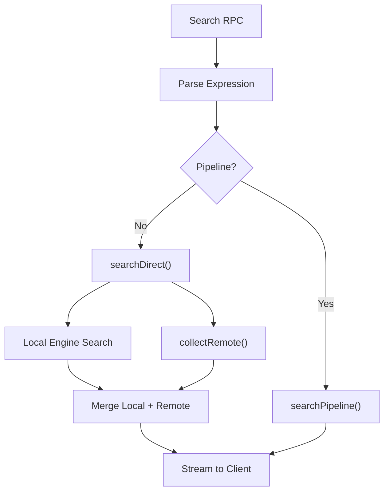
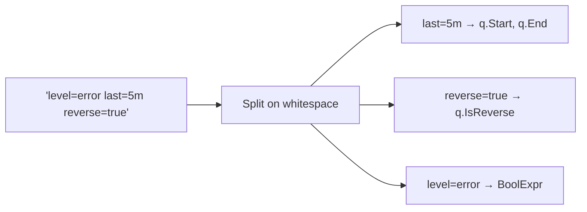
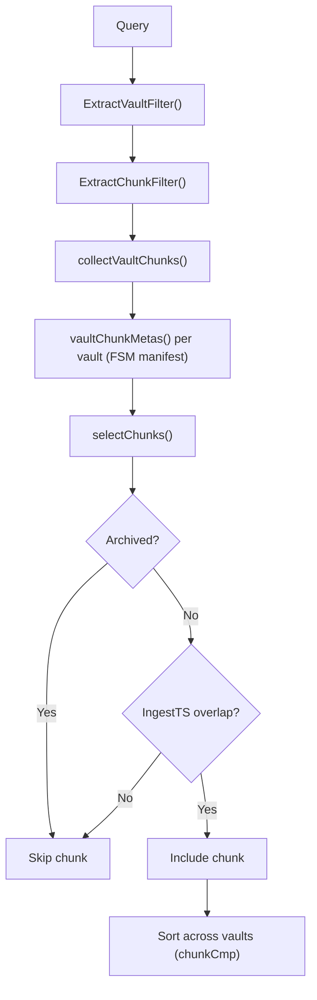
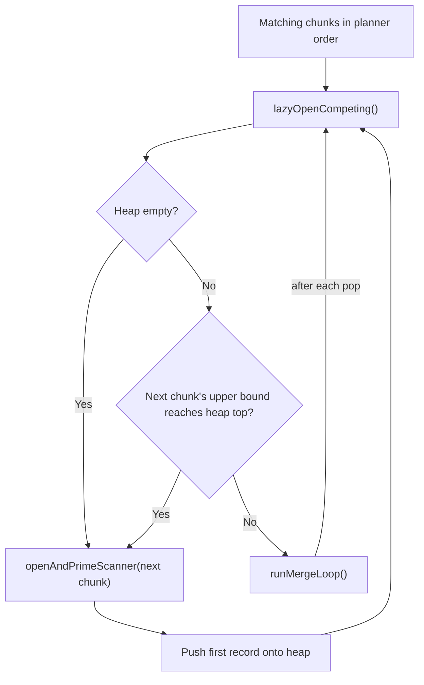
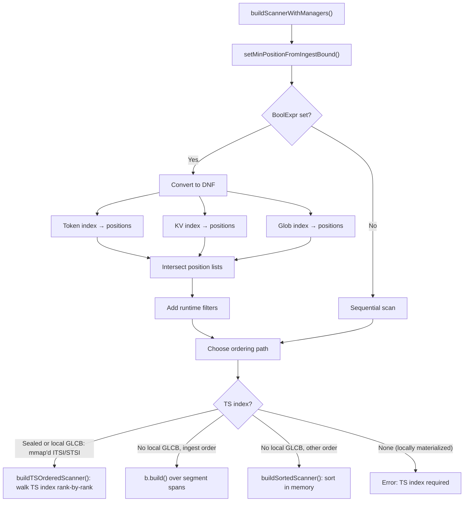
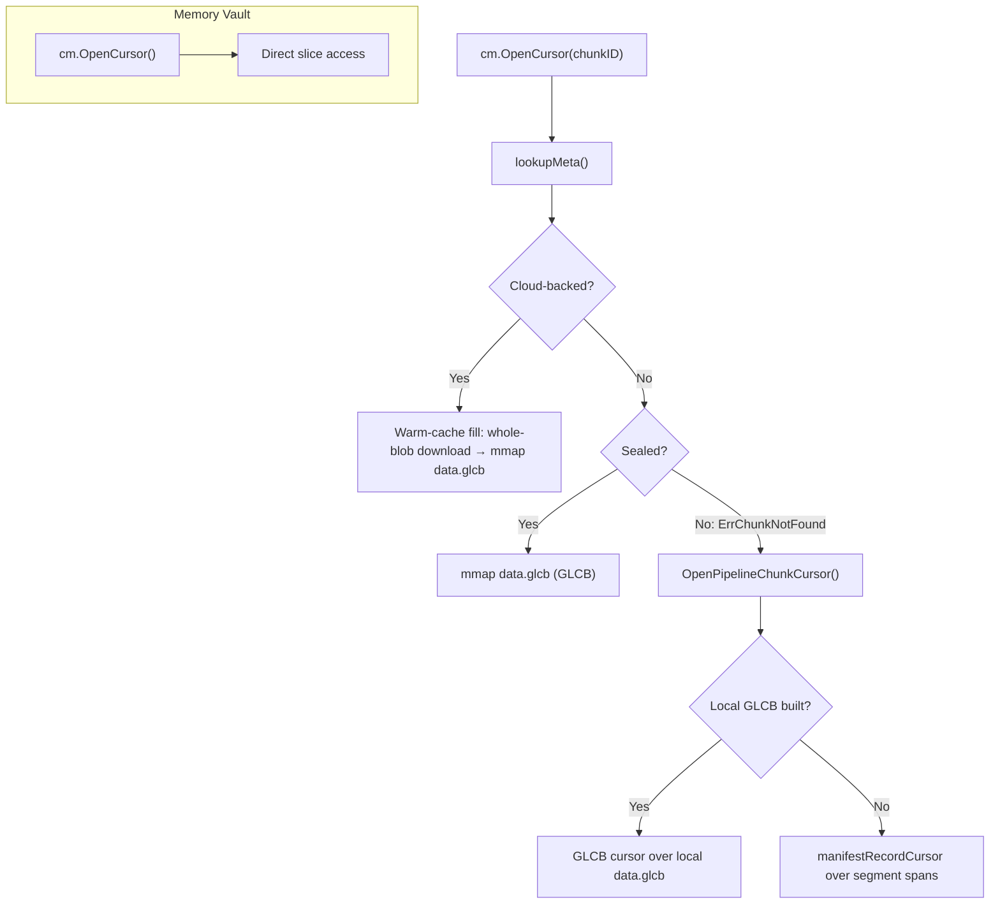
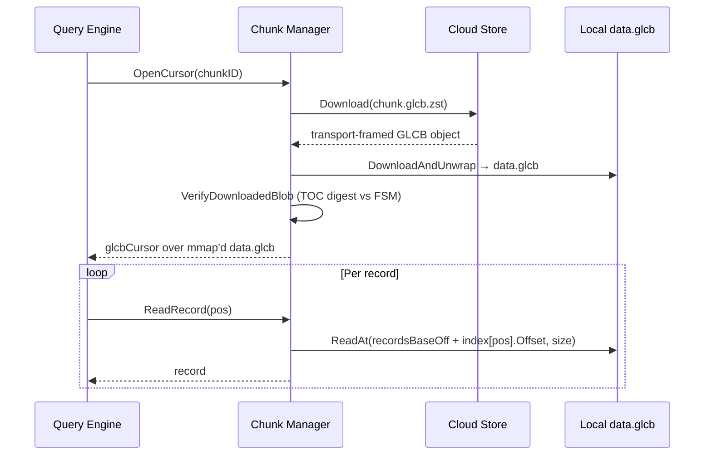
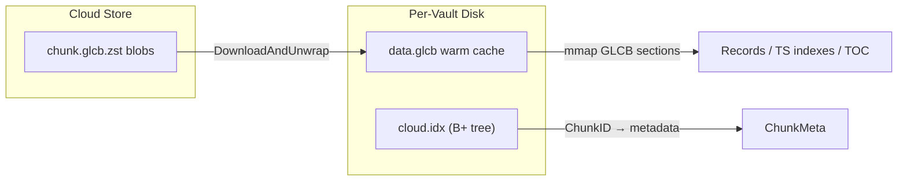
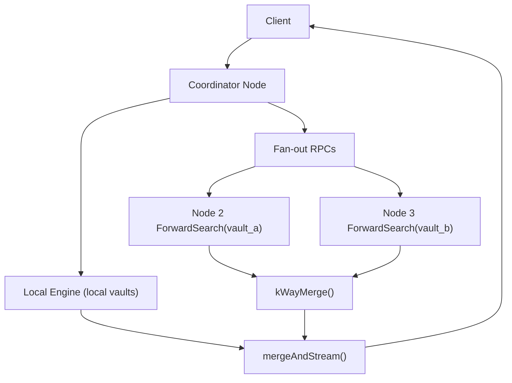
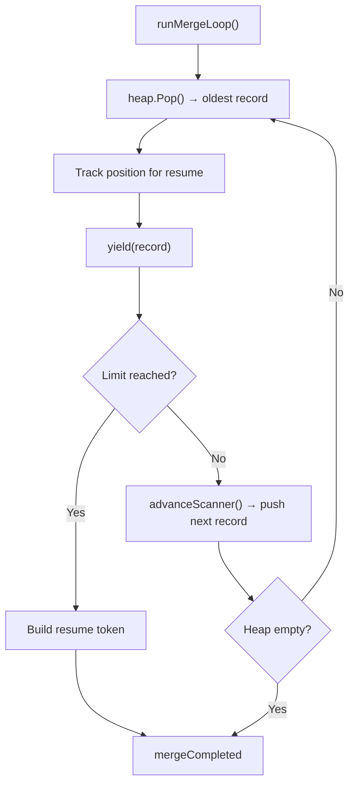

# Query Execution Pipeline

How a query travels from RPC request to streamed results, covering file vaults,
memory vaults, local chunks, cloud-backed chunks, and multi-node fan-out.

## High-Level Flow

## Expression Parsing

The expression string (e.g. `level=error last=5m limit=10`) is parsed in
`server/query_convert.go → parseExpression()`. Whitespace-separated tokens are
classified by `applyDirective()` as either **directives** (key=value pairs the
engine understands) or **filter predicates** (fed to the query language parser).

| Directive | Effect |
|-----------|--------|
| `last=<dur>` | Sets `Start = now-dur`, `End = now` |
| `start=<t>` / `end=<t>` | Explicit IngestTS bounds (RFC3339, RFC3339Nano, or Unix seconds — `parseTime()`) |
| `source_start=` / `source_end=` | SourceTS bounds: the seek key under `order=source_ts`, a runtime filter otherwise. `start=`/`end=` stay ingest bounds under every ordering |
| `limit=<n>` | Max records to return |
| `reverse=true` | Newest-first ordering |
| `order=source_ts` | Switch ordering from default IngestTS |
| `pos=<n>` | Single record by position |

Remaining tokens become filter predicates parsed by `querylang.ParsePipeline()`,
producing a `BoolExpr` tree (AND/OR/NOT over token matches, KV predicates, globs).

## Vault and Chunk Selection

**Chunk listing.** `vaultChunkMetas()` (`query/histogram.go`) reads chunk
metadata from the vault-ctl FSM manifest: the registry's `SearchChunkMetas`
resolves to the orchestrator's `SearchChunkMetasForVault`
(`orchestrator/pipeline_search.go`), which returns every manifest entry —
sealed chunks and the active and sealing pipeline chunks — with timestamp
bounds overlaid. On a node with no vault-ctl FSM for the vault it falls back to
the manifest reader's sealed entries plus the chunk manager's active chunk; with
no registry wired at all, to `cm.List()`. For **memory vaults**, all chunks are
in-memory.

**`selectChunks`** filters chunks by time overlap. A chunk is included if its
`[IngestStart, IngestEnd]` range intersects the query's `[lower, upper]` bounds;
`source_start=`/`source_end=` bounds apply the same test to
`[SourceStart, SourceEnd]`. Active chunks get the same test as sealed ones. A
bound that is still zero does not exclude a chunk, except that under a
time-bounded query a Sealed or Sealing chunk with neither `IngestStart` nor
`IngestEnd` known is excluded rather than treated as matching everything.

**Sort order** (`chunkCmp`, `query/query.go`) is global across vaults, because
lazy priming assumes adjacent chunks are time-ordered. Forward: ascending
start (`IngestStart`, or `SourceStart` under `order=source_ts`). Reverse:
unsealed chunks first — they may hold records newer than their metadata —
then descending end, then descending start.

## Merge Heap Priming

The engine uses a min-heap to merge records from multiple chunks in timestamp
order. Priming opens a scanner for a chunk and pushes its first record onto the
heap. Chunks are primed **lazily, in planner order**: `lazyOpenCompeting()`
opens the next pending chunk only while it can still compete for the next
merge record.

For chunks whose time ranges do not overlap, only one scanner is open at a
time; for overlapping ranges, every chunk whose upper bound can still beat the
current heap top is opened. `runMergeLoop()` calls `lazyOpenCompeting()` again
as the heap advances, so a chunk is opened only when the merge reaches it. A
`last=5m limit=10` query that fills its limit from the newest chunks never opens
older ones — local or cloud-backed alike. There is no separate local/cloud
priming pass. (The `limit=` directive works in both the UI query input and the
CLI's `--limit` flag.)

## Scanner Pipeline

Each chunk gets a scanner built from composable stages. The scanner determines
which records to read and in what order.

### Position Narrowing

For **sealed chunks** with indexes, the engine narrows which records to read:

1. **Time-based**: on a sealed chunk whose IngestTS never decreases in
   physical order (`IngestTSMonotonic`), the records an ingest lower bound
   excludes are exactly the leading positions, as many as the bound's rank in
   the ITSI, so that rank becomes the minimum position → `setMinPosition()`.
   Posting lists are pruned below it and the rank walk skips reading records
   below it, which saves reads under `order=source_ts` (under the default
   order the ingest rank range already starts past them). No other time bound
   narrows by position: on a chunk whose records arrived out of IngestTS
   order, and on every chunk for SourceTS (late, replayed and multi-source
   logs arrive out of source order), an admitted record can sit at any
   position, so those bounds act only as the rank range on the ordering axis
   and a per-record check. Active chunks are not narrowed either; their
   monotonicity can change while a scan runs.
2. **Token index**: posting lists intersected for all required tokens
3. **KV index**: positions of records matching key/value predicates
4. **Glob index**: prefix-based positions, verified at runtime

If positions are available, a **position scanner** seeks directly to each one.
Otherwise, a **sequential scanner** reads records in order, applying runtime
filters.

### TS-Ordered Scanning

Records are stored in physical write order (WriteTS) but must always be yielded
in IngestTS order (the default) or SourceTS order:

| Chunk Type | Strategy |
|------------|----------|
| Sealed (local or warm-cached cloud) | Walk the embedded mmap'd ITSI/STSI rank-by-rank, seek to positions in TS order |
| Active or Sealing pipeline chunk with a local GLCB | Same rank-ordered path over the GLCB's embedded ITSI/STSI |
| Active or Sealing pipeline chunk without a local GLCB, ingest order | Sequential scan (`b.build()`) of the manifest-listed segment spans, which already yield in ingest order |
| Active or Sealing pipeline chunk without a local GLCB, any other ordering | Sorted in memory (`buildSortedScanner`, `query/order_sort_scanner.go`): one pass collects each surviving record's ordering key and position, charged against the memory budget, then the records are read back sorted |
| Locally materialized, no rank view | Query fails with `TS index required` |

## Chunk Access Paths

### File Vault Cursors

| Chunk State | Cursor Type | I/O Method |
|-------------|------------|------------|
| Active or Sealing (pipeline), local GLCB built | GLCB cursor (`chunking.OpenGLCBCursor`) | Memory-mapped local `data.glcb` |
| Active or Sealing (pipeline), no local GLCB | `manifestRecordCursor` | Reads the manifest-listed segment spans; the first `Seek` switches to a positional reader |
| Sealed (local) | `mmapCursor` | Memory-mapped GLCB, random access via record-index offsets |
| Cloud-backed | `glcbCursor` (after warm-cache fill) | One whole-object download → reassemble GLCB → mmap; reads are local from then on. Histogram rank lookups on cold chunks skip the fill: the ITSI section arrives via KB-scale range GETs |

Active and Sealing pipeline chunks come from the FSM manifest, not from the
chunk manager. `openSearchChunkCursor()` (`query/query.go`) tries
`cm.OpenCursor()` first; on `ErrChunkNotFound` it opens the chunk through
`OpenPipelineChunkCursor()` (`orchestrator/pipeline_search.go`), which reads
the local GLCB when this home has built it and the manifest-listed segment
spans otherwise. A Sealing chunk without a local GLCB therefore does not fail:
it is scanned sequentially or sorted in memory as described under TS-Ordered
Scanning. A chunk the manifest lists but this node cannot open at all is
skipped with a warning.

### Memory Vault Cursors

Memory vaults hold records in Go slices. `OpenCursor()` returns a cursor backed
by direct slice indexing — no disk I/O, no file formats.

### Cloud-Backed Chunk Read Path

Cloud-backed chunks are primed lazily in planner order like every other chunk
(see Merge Heap Priming): a cloud cursor opens only when the merge reaches the
chunk, so a query whose limit fills from newer chunks does no cloud I/O. A
cloud-backed chunk whose blob cannot be read is skipped with a warning
(`handleCloudPrimeError`) instead of failing the query.

Reads go through a whole-blob download and warm-cache fill. The first cursor
pays one download; every subsequent read on the same chunk goes through the
local mmap fast path:

The local cache is byte-for-byte equivalent to a freshly-sealed local
chunk. Subsequent queries reuse the cache; eviction policy reclaims
disk space under pressure (`gastrolog-2idw8`).

## Cloud Index Infrastructure

Cloud-backed chunk metadata lives in a B+ tree on disk (`cloud.idx`), not in the Go
heap. This keeps memory stable regardless of cloud-backed chunk count.

**Warm cache.** First read of a cloud-backed chunk pulls the
zstd-wrapped blob, decompresses it into a local `data.glcb`, and verifies
the TOC's blob digest against the FSM-stamped value (gastrolog-grnc3).
The TS index, record index, and records all live in the same file from
that point on — `pread`-based binary search runs against the local mmap
with no further cloud I/O.

## Multi-Node Cluster Query

The query travels to a peer as text: the coordinator prints the parsed filter
and pipeline back into query syntax and the peer parses it again. That printer
(`Expr.String()`, `Pipeline.String()`) is therefore a wire format, not a
diagnostic: every predicate kind prints as syntax the parser reads back as the
same predicate, values are quoted whenever the lexer could not take them as a
bareword (the empty string included), and a pipeline without a filter prints
with its leading `|`. A round-trip test and a fuzzer pin this.

The directives travel in the same text, written by `forwardedQueryExpression`
next to the parser that reads them back: the filter, then `start=`, `end=`,
`source_start=`, `source_end=` (absolute, nanosecond timestamps), `reverse=`,
`order=`, `limit=` and `pos=`. A peer therefore scans under exactly the bounds,
ordering and position the coordinator's own scan uses — a vault led on another
node honours a source-time window or a `pos=` address the same way a local one
does. A legacy token/key-value query is folded into its filter first, so it
never reaches a peer as an unfiltered scan. What the text does not carry
travels in the request beside it: the resume cursor in `ResumeToken`, the
partial-aggregate request in `PartialAggregates`, the histogram request in
`HistogramOnly`. A test fails when a
`query.Query` field is neither round-tripped through the wire form nor named
with the channel that carries it instead. `Query.String()` is a display form
for Explain, not the wire.

The coordinator determines which vaults live on peer nodes via
`remoteVaultsByNode()`. For each remote vault, a streaming `ForwardSearch` RPC
is opened. Results flow back without buffering — `kWayMerge()` performs
selection-based merging across N streams (N is typically 1–3 vaults per node).

**Every merge uses one order**: `OrderBy.CompareRecords` — the ordering
timestamp, then `chunk.EventID`'s own total order (IngestTS, NodeID,
IngesterID, IngestSeq), with `reverse` negating the whole comparison. That
applies at all three levels: a node's `tsHeap` fan-in across its own vaults and
chunks, the coordinator's `kWayMerge` fan-in across remote vaults, and the
local/remote merge on top of them.

A timestamp tie is ordinary rather than exotic — under `order=source_ts` a
whole second of syslog shares one timestamp, so a `head`/`tail` cutoff lands
inside a tie group as a matter of course. Ranking such records by which side
was "local", by vault ID, or by an entry's position in a concurrently-built
merge slice would make the same query return a different window depending on
which node the client connected to and on how routing fanned copies across
vaults. EventID's fields are intrinsic to the event and identical on every copy
of it, so every node ranks any two records the same way.

**Histograms travel beside records, never inside them.** The page-1 histogram
covers the whole window, while a vault's record stream stops at the page
limit, so no record scan can produce it: a filtered histogram is its own scan
of the window (`timechartScanPath`), an unfiltered one counts from the
timestamp index. On the first page the coordinator computes its own leader
vaults' share and, concurrently, `collectRemoteHistogram` sends every remote
vault's leader a `ForwardSearch` with `histogram_only` set; the peer answers
with `ComputeSearchPageHistogram` over the forwarded query — the function the
coordinator runs for its own vaults — and no records. The shares sum bucket by
bucket on the grid every node derives from the same absolute window. Record
streams carry no histogram, and later pages ask for none, so no record waits on
a histogram's scan and the response's closing message is the only one that
does. Pipeline searches merge the remote shares the same way. If any remote
vault fails to answer, the response carries no histogram: a sum missing one
vault's share would understate volume while looking authoritative. A remote
vault whose record stream fails fails the search itself.

**Resume tokens** carry the coordinator's local chunk positions plus one
canonical cursor for the merged stream: the last emitted record's timestamp on
the ordering axis and its EventID. Remote vaults are not resumed by their own
tokens; the next page bounds every source at the cursor's timestamp
(inclusively) and the merge skips whatever sits at or before the cursor in
canonical order, so a page boundary inside a group of records sharing a
timestamp neither repeats nor drops any of them, from any node. Local positions
advance only past records the page displayed: the merge reads one local record
ahead to compare against the remote stream, so a page filled entirely by remote
records hands on the local positions it received, and a page that displayed a
local record pins them to the last one shown. Positions are
kept only for chunks scanned in physical order. A chunk scanned through its
timestamp index (every sealed chunk, and any ordering other than the default)
yields in index order, so no physical position can resume it; it carries none,
and the next page restarts it under the cursor, which the narrowed time bound
lets the rank scan seek to directly. An open pipeline chunk has no source
index yet; under `order=source_ts` it is put in canonical order in memory —
one pass collects each surviving record's ordering key and position, charged
against the query's memory budget until the chunk is done, and the records are
read back sorted. The engine applies its own token's cursor,
so pagination is exact at the engine boundary too, not only through the
server. This is what makes `order=source_ts` pageable on the same terms as
the default ordering.

## Query Memory Budget

Pipeline operators control their own result limits, so the incoming `Limit`
caps a pipeline's output and never its scan: a scan limit would cut an
aggregator's or a sort's *input*, making `| stats count` report the count of an
arbitrary prefix and `| sort` order one. The scan reads every match unless a
`head` is reached through operators that keep every record (`eval`, `rename`,
`fields`, `lookup`); then the head's N is all the pipeline can consume, and
that N is the scan limit. A `where` or `dedup` ahead of the head drops records,
so it scans every match. What bounds the work instead is a per-query memory
budget (`query.MaxQueryMemoryBytes`, 256 MiB), which bounds retained bytes
without changing the answer.

Every path that retains data charges it: the record buffer behind an uncapped
sort, the top-N working set behind a capped one, the slot array a `tail`/`slice`
declares, the dedup seen-event set, stats group state, the collections
inside `dcount`, `median`, `values`, `first`, and `last`, the sort keys of an
unindexed chunk put in source order, and the histogram's working state. Records are charged
*after* field extraction, since the JSON/logfmt fields that materialization
moves into `Attrs` are most of what a buffered record retains. Exceeding the
budget fails the query with a `query.MemoryLimitError` naming the structure that
overflowed and the ceiling; the RPC layer surfaces it as `ResourceExhausted`.
A peer whose share overflows answers its forwarded search, follow, or context
request with a `ResourceExhausted` status, and the coordinator passes that code
on to the client, so the same query fails the same way whichever node holds the
data. The overflow is the query's size, not the vault's health: it is never
reported as a vault read failure and raises no vault alarm.
The budget never trims a result to fit.

Two older caps do produce a partial table, and both label it: exceeding
`MaxGroupCardinality` stops admitting new `stats` groups, and gap-fill stops
padding empty bins when it would exhaust the cardinality cap or the budget.
Both set `TableResult.Truncated`, which travels to the client, so the partial
result is flagged rather than silent — but it is still partial, which is a
different contract from the budget's outright failure.

The budget is **per query, per node**. Each node executing part of a fan-out
gets its own, and runs its whole share on one ledger (`query.Budget`): the
caller opens it with `Engine.NewBudget` and attaches it with
`Query.WithBudget`, or hands it to `RunPipelineWithRemote`, and every engine
entry point charges the ledger its query carries, opening one only when the
caller attached none. On the coordinator that ledger covers the local scan,
the page-1 histogram, and the records streaming back from peers. Every chunk
the merge holds open charges the same ledger, so several unindexed chunks
sorted at once are bounded together rather than each against its own ceiling.
A structure that finishes before the query hands back what it held: a sorted
scanner releases its keys when its chunk is drained or abandoned, and the
histogram charges a sub-account it closes when its buckets are built. The
page-1 histogram runs on its own goroutine beside the scan, so the ledger is a
single atomic counter, safe for concurrent use without a lock on the charge
path. There is no cluster-wide total: the exhaustion being prevented is a node
running out of memory, a per-node resource, and a shared counter would need a
cluster round trip on the per-record path.

A pipeline that ends in `stats` or `timechart` with combinable aggregates
(`count`, `sum`, `min`, `max`, `avg`) is split at the aggregating operator. Every node
runs the filter, the operators ahead of the aggregate, and the aggregate
itself; the coordinator merges the per-node tables by the operator's structure
— the leading columns are the group keys, the rest are the aggregates in
declaration order, each combined by its own rule — and then runs the operators
after the aggregate (`where`, `eval`, `sort`, `head`, …) once over the merged
table. Column names play no part in the merge, so an alias cannot hide an
aggregate, and a filter after `stats` sees the cluster's count rather than each
node's share of it. Every node is asked for *partial* aggregates: an `avg`
arrives as its sum and its count, and the coordinator divides once, so the
cluster average never needs the records.

A pipeline the cluster cannot answer by merging per-node results — a `head`,
`tail`, or `slice` that would otherwise apply once per node, a `dedup` whose
window spans nodes, or an aggregate like `dcount`/`median`/`values` that
cannot be recombined from partials — runs once on the coordinator over every
node's records. Every peer scans for it under the pipeline's scan limit
(`query.PipelineScanLimit`), the same one the coordinator's local scan uses,
never under the client's page size: the page size caps what the pipeline
returns, not what it reads. Those records are
*streamed* through it, merged with the local scan in query order, not collected
first: the coordinator retains only what the pipeline's own operators hold, so
memory tracks the answer rather than the match set. An uncapped `sort` is the
one shape that genuinely has to hold every record, and the budget is what
bounds it. A `timechart` behind such an operator bins from that merged stream
rather than from the coordinator's chunk metadata, so its buckets hold the
survivors of the cap applied cluster-wide; without an explicit time range they
span those survivors, whichever node coordinates.

The ceiling is a fixed constant rather than a setting. A node runs queries for
every vault it leads, so raising it to make one query fit would re-arm the same
exhaustion for every other vault on that node; the remedy for a query that does
not fit belongs in the query.

## Merge Loop

The merge loop pops the entry with the smallest timestamp (or largest, for
reverse queries) from the heap, yields it to the client, and advances that
chunk's scanner to get the next record. When the limit is reached or the heap
is empty, it builds a resume token encoding each chunk's last-returned position.
