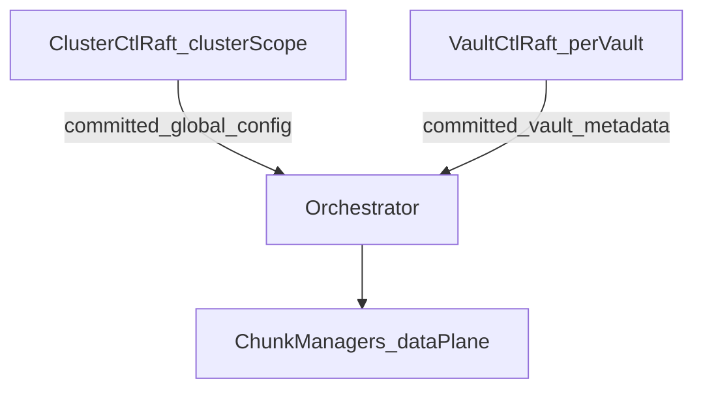
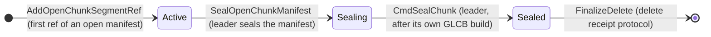
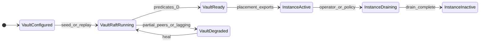

# Vault-level control-plane architecture

**Uniform Raft group model:** cluster-ctl Raft and every vault-ctl Raft group share **lifecycle and on-disk conventions**. The one structural difference — cluster-ctl Raft is opened directly rather than through `GroupManager`, on its own WAL — is named under [Lifecycle](#lifecycle) and [Persistence](#persistence); there is no undocumented privileged directory layout.

There are **no** per-vault-instance metadata Raft groups. **One vault-ctl Raft group per vault** (plus cluster-ctl Raft for cluster-global config) owns every cross-node chunk metadata mutation. **Vault instances** (chunk/index managers) are the data plane and **do not** host their own Raft groups.

**Vocabulary:** canonical terms follow [`ubiquitous_language.md`](./ubiquitous_language.md). In particular, this architecture uses **vault-ctl Raft** (one group per vault, authoritative for that vault's chunk metadata) and **instance FSM** (the per-vault-instance sub-state-machine inside the vault-ctl FSM, implemented in `vaultctlfsm`).

---

## Table of contents

1. [Inventory](#inventory)
2. [A) Vocabulary (normative)](#a-vocabulary-normative)
3. [B) Authority model (normative)](#b-authority-model-normative)
4. [C) Uniform Raft group model](#c-uniform-raft-group-model)
5. [D) Vault readiness semantics](#d-vault-readiness-semantics)
6. [E) Legal state machine (chunk / vault)](#e-legal-state-machine-chunk--vault)
7. [F) Open questions](#f-open-questions)
8. [Code anchors (maintenance)](#code-anchors-maintenance)

---

## Inventory

### Cluster-ctl Raft

| Aspect | Detail |
|--------|--------|
| **Entry** | `openRaftClusterCtlStore` in [`backend/internal/app/raft.go`](../backend/internal/app/raft.go) |
| **Persistence** | Its own WAL: `raftwal.Open(Home.ClusterCtlWALDir())` (`raft/wal`) with `GroupStore("cluster-ctl")`; file snapshot store `hraft.NewFileSnapshotStore(Home.RaftGroupDir("cluster-ctl"), …)` (`raft/groups/cluster-ctl`). Layout helpers in [`backend/internal/home/home.go`](../backend/internal/home/home.go) |
| **Transport** | `cluster.Server.Transport()` — the multiraft transport scoped to group ID `config` (`cluster.ConfigGroupID`); not a `GroupManager` group |
| **Apply path** | `cluster.SetApplyFn` → `raftstore.Store.ApplyRaw` (config mutations) |

### Vault control-plane Raft (per vault, `vault/<id>/ctl`)

| Aspect | Detail |
|--------|--------|
| **Entry** | `ensureVaultControlPlaneRaftGroup` in [`backend/internal/orchestrator/reconfig_vaults.go`](../backend/internal/orchestrator/reconfig_vaults.go) |
| **FSM** | [`backend/internal/vaultraft/`](../backend/internal/vaultraft/) — holds per-instance sub-FSMs ([`vaultctlfsm.FSM`](../backend/internal/vaultraft/vaultctlfsm/)) namespaced by `OpVaultChunkFSM` commands |
| **Cross-node apply** | `orchestrator.ApplyVaultControlPlane` → `cluster.VaultApplyForwarder` when `PeerConns` is set, else local `Raft.Apply`; RPC path: `ForwardVaultApply` + `cluster.SetGroupApplyFn` ([`backend/internal/orchestrator/vault_ctl_apply.go`](../backend/internal/orchestrator/vault_ctl_apply.go), [`backend/internal/cluster/vault_apply_forwarder.go`](../backend/internal/cluster/vault_apply_forwarder.go), [`backend/internal/cluster/forward.go`](../backend/internal/cluster/forward.go), [`backend/internal/app/app.go`](../backend/internal/app/app.go)) |
| **Client forwarder** | [`backend/internal/cluster/vault_apply_forwarder.go`](../backend/internal/cluster/vault_apply_forwarder.go) (`VaultApplyForwarder`) |

### Vault chunk metadata (cluster mode)

Replicated chunk metadata uses the **vault control-plane** group only (`OpVaultChunkFSM` wrapping `vaultctlfsm` wire payloads). Entry: `bindVaultInstanceToCtlLocked` in [`backend/internal/orchestrator/reconfig_vaults.go`](../backend/internal/orchestrator/reconfig_vaults.go). Cross-node apply uses `ForwardVaultApply` with the vault-ctl `group_id` and wrapped command bytes (`cluster.NewVaultCtlChunkApplyForwarder`).

### Deferred group creation and instance binding

A node creates a vault's vault-ctl group only with the complete voter set: every node in the cluster node list resolvable, the local node among them (`tryStartClusterWideRaftGroup`). Otherwise creation **defers** — a joiner whose own `NodeConfig` has not reached the node list yet, or a peer not yet in the cluster-ctl Raft configuration. The vault still registers, and a node with a placement still builds its local instance.

`RefreshVaultCtlMembers` (dispatched on every node-config put and delete) retries: once the member set is complete it creates each missing group.

Two bindings attach consumers to a group, and both run wherever the group and its consumers meet:

| Binding | What it wires | Runs on |
|---------|---------------|---------|
| `bindVaultCtlGroup` (vault level, every node) | after-restore hook, the vault-ready signal on the group FSM's first apply, pipeline chunk events on the live sub-FSM, the vault-ctl leader loop | group ensure (build, `AddVaultInstance`, `RefreshVaultCtlMembers`), snapshot restore |
| `bindVaultInstanceToCtlLocked` (local instance) | once, at registration: the Raft-backed facets (`IsFSMReady`, apply callbacks, manifest reads) and the announcer; per live sub-FSM: the lifecycle reconciler's callbacks, `OnCreate` / `OnUpload`, the lazy cloud-backed resolver | instance registration (`AddVault`, `AddVaultInstance`, `RegisterVault`), `RefreshVaultCtlMembers`, snapshot restore |

The facets and the announcer's applier read the instance's group pointer — stored by the binding once the group exists, read lock-free because the facets run on Raft apply goroutines — and resolve the sub-FSM through it on every call instead of capturing it, so they are correct before the group exists, after it is created, and across restores without ever being rewritten on a live instance. The sub-FSM pushes its events to whatever subscribed to it, so those subscriptions follow the live sub-FSM: the instance binding records the sub-FSM it subscribed to and is a no-op while that one is still live; a snapshot restore replaces the sub-FSM, so the restore pass subscribes the replacement. The leader loop is started through `vaultCtlLeaderManager.Start`, which runs at most one loop per vault.

**Readiness while deferred:** deferral makes the **vault** not ready on that node. While the group does not exist, the instance has no group to read and `IsFSMReady()` reports `false`, so `ReadinessErr` returns `ErrVaultNotReady` until the group exists and its FSM has applied its first entry (`vaultraft.FSM.Ready`). The FSM stores configuration entries as well as commands (`hraft.ConfigurationStore`), so a fresh group becomes ready when its bootstrap configuration applies. Readiness reads the FSM's own count rather than `r.AppliedIndex()`, which Raft advances before the FSM has run and would report ready before the state is there. A node without vault-ctl Raft at all (no `GroupManager` or no node address resolver: single-node/memory mode) leaves `IsFSMReady` nil and the instance is ready — its own chunk manager is authoritative.

### Orchestrator

Vault / chunk operations and routing: [`backend/internal/orchestrator/vault_ops.go`](../backend/internal/orchestrator/vault_ops.go) and related orchestrator code; replicated metadata callbacks from `bindVaultInstanceToCtlLocked` / `vaultRaftCallbacks` read the per-instance sub-FSM inside [`backend/internal/vaultraft/`](../backend/internal/vaultraft/).

### Status

1. **Authority scope:** Replicated chunk metadata is on **vault control-plane Raft** (cluster mode).
2. **Snapshot layout:** Every group snapshots under `raft/groups/<groupID>/` — `raft/groups/cluster-ctl` for cluster-ctl, `raft/groups/vault/<vaultID>/ctl` for each vault-ctl group.
3. **WALs:** Two per node. Cluster-ctl has its own `raftwal` at `raft/wal` (`Home.ClusterCtlWALDir`) so cluster heartbeats are not coupled to vault append/fsync batching; every vault-ctl group on the node shares one `raftwal` at `raft/groups/wal` (`Home.VaultCtlWALDir`, opened in `setupMultiRaft`).
4. **Readiness / partial peers:** `Vault.ReadinessErr` ([`vault_readiness.go`](../backend/internal/orchestrator/vault_readiness.go)) gates on the instance's `IsFSMReady` callback, which `buildVaultRaftCallbacks` wires to the vault-ctl group FSM's `Ready` (first entry applied or snapshot restored).
5. **Apply entrypoints:** **One** `cluster.Server.SetGroupApplyFn`; `ForwardVaultApply` is the single cross-node apply RPC.
6. **Reads of a vault that is not ready:** a search, its histogram, a pipeline and Explain leave a vault out while it is not ready on its leader, the same from every node. The leader's engine registries hide the vault from a query this node runs, and a forwarded query answers with a **not-ready answer**: an `Unavailable` status carrying the `VAULT_NOT_READY` `ErrorInfo` reason (`cluster/vault_not_ready.go`), which the calling node's peer-status error matches as `ErrVaultNotReady` — the orchestrator's sentinel is the cluster package's, so one `errors.Is` check covers both origins. The coordinator drops such a vault's stream, table or histogram share and does not report it among the contributing vaults; any other remote failure still fails the query. A not-ready answer that ends a stream which already delivered records fails the query, since that vault's share would be incomplete. A context read whose anchor is in a vault not ready on another node answers `Unavailable`. The search response has no field naming a vault left out, so a not-ready vault is absent without a mark.

---

## A) Vocabulary (normative)

| Term | Definition |
|------|------------|
| **Control plane** | Replicated metadata and decisions that must survive restart and agree cluster-wide (Raft-backed configuration, placement-derived invariants that affect safety, chunk metadata that must not fork across nodes). |
| **Data plane** | Bytes on disk / object store / cloud blobs and record streams; may be locally authoritative under placement rules but **must not** contradict committed control-plane state. |
| **Authority** | The sole writer path for a given decision (typically through the Raft leader for that group). |
| **Cache / hint** | Read models that may lag (peer discovery, placement views). **MUST** be labeled as such; **MUST NOT** be the only source for unsafe actions. |
| **Vault readiness** | Predicate bundle (section D) for whether this node may execute **vault-scoped** control-plane responsibilities for a vault. |
| **Instance readiness** | Whether this node may operate a **specific vault instance** (local placement) — may depend on vault readiness + local placement + resource state. |
| **Node readiness** | Process-level (gRPC up, cluster-ctl Raft available, etc.) — orthogonal to vault readiness. |

---

## B) Authority model (normative)

**MUST**

- Every mutation that changes **cross-node** interpretation of vault/chunk metadata **MUST** go through a **defined Raft group** (cluster-ctl or vault-ctl), or through an explicitly documented non-Raft path that remains safe under partition (rare; default is “no”).
- **Cluster-ctl Raft** is the home for **cluster-global** configuration and membership that is not vault-owned: anything not naturally keyed by vault ID stays cluster-scoped.
- **Vault-scoped** control-plane state **MUST** be keyed and replicated under the vault's **vault-ctl Raft** group (section C), not ad hoc sub-Raft groups for vault-wide invariants.

**MUST NOT**

- Introduce a second silent writer path for the same metadata (e.g. direct boltdb / local files that diverge from what Raft would apply).
- Treat placement caches, peer tables, or “last known leader” hints as authoritative for commits that need consensus.

**Partial membership / unresolved peers**

- **MUST** inherit the safety principle: **do not bootstrap** a new Raft group with an incomplete voter set when that would bake a bad configuration.
- **Deferred creation** makes the **vault** not ready on that node (see [Deferred group creation and instance binding](#deferred-group-creation-and-instance-binding)): ingest, query and control paths return `ErrVaultNotReady`, and reads leave the vault out (Status item 6).

---

## C) Uniform Raft group model

### Topology

- **Cluster-ctl Raft:** global cluster config and membership.
- **Vault-ctl Raft (one group per vault):** authoritative for **all** vault/chunk control-plane metadata. The group's FSM (`vaultraft.FSM`) hosts the chunk FSM as a sub-FSM (`vaultctlfsm`).
- **Chunk path (data plane):** consumes committed state from vault-ctl and cluster-ctl Raft; **does not** host Raft; **does not** own consensus for cross-node metadata.

### Identifiers and routing

- String `GroupID` is the routing key for `multiraft.GroupTransport` ([`backend/internal/multiraft/transport.go`](../backend/internal/multiraft/transport.go)).
- **Vault-ctl Raft** uses `vault/<vaultGLID>/ctl` (`raftgroup.VaultControlPlaneGroupID`) and is the **only** vault-scoped multiraft group for replicated chunk metadata. Cluster-ctl Raft routes on the multiraft transport as group `config` (`cluster.ConfigGroupID`); its on-disk name is `cluster-ctl`.

### Persistence

- **WAL:** Split WALs with an identical semantic contract: cluster-ctl on `raft/wal`, all vault-ctl groups sharing `raft/groups/wal`. The split exists for I/O isolation — cluster-ctl heartbeats must not wait on vault append/fsync batching.
- **Snapshots:** One directory pattern for all group kinds: `raft/groups/<groupID>/`, with cluster-ctl at `raft/groups/cluster-ctl`. There is no on-disk upgrade path from another layout: when the layout changes, the raft tree is wiped.

### Lifecycle

- **Create / seed / restart:** Vault-ctl groups are created, seeded and restarted through `GroupManager` ([`backend/internal/raftgroup/groupmanager.go`](../backend/internal/raftgroup/groupmanager.go)). Cluster-ctl Raft is not a `GroupManager` group: `openRaftClusterCtlStore` opens it directly, and `setupMultiRaft` leaves `GroupManagerConfig.ShutdownLast` empty for that reason.
- **Shutdown:** Raft shuts down before its transport is removed (`DestroyGroup`). Changes to vault-ctl groups **MUST NOT** weaken this ordering.

### Authority direction

---

## D) Vault readiness semantics

The canonical definition is in [`vault_readiness.go`](../backend/internal/orchestrator/vault_readiness.go). A vault is ready on a node when it has a local instance and that instance's vault-ctl group FSM has applied at least one entry or restored a snapshot (`vaultraft.FSM.Ready`, wired as the instance's `IsFSMReady`). A vault whose group creation is deferred is not ready (see [Readiness while deferred](#deferred-group-creation-and-instance-binding)). One gate covers ingest, query and control paths on the node: `Vault.ReadinessErr` returns `ErrVaultNotReady` until the vault is ready, and callers retry with backoff. The node's `/readyz` probe answers ready only while the orchestrator runs, the server is not draining, and `LocalVaultsReplicationReady` holds — every vault with a local instance is ready.

**Consistency**

- Caches of vault-ctl state **MAY** be eventually consistent only where the allowed staleness is stated and the failure mode is bounded.

---

## E) Legal state machine (chunk / vault)

Documents the transitions that flow through `vaultctlfsm` / vault-ctl Raft applies (`reconfig_vaults.go` callbacks) and which transitions are **vault Raft commands** vs **local instance** bookkeeping.

Chunk substates (delete pending, tombstone, etc.) are mapped to: **vault-committed**, **instance-local**, or **cluster-committed** (cluster-ctl Raft).

### Chunk lifecycle (pipeline vaults)

A chunk traverses three FSM-tracked states (`chunk.ChunkState` on the vault-ctl `ManifestEntry`). The state is `vault-committed` (replicated through the per-vault control-plane Raft). The vault-ctl leader plans chunks as open chunk manifests over published segments; every home builds its own GLCB from the sealed manifest.

| State    | Producer trigger | Bytes on each home | Reads |
|----------|------------------|--------------------|-------|
| Active   | `applyAddOpenChunkSegmentRef` ([`vaultctlfsm/open_chunk.go`](../backend/internal/vaultraft/vaultctlfsm/open_chunk.go)) creates the `ManifestEntry` in `Active` when the first segment ref lands in the open manifest | Segments in `head/`; no GLCB | `OpenPipelineChunkCursor` reads the manifest-listed segment spans |
| Sealing  | `applySealOpenChunkManifest` moves the open manifest onto the FIFO sealed-manifest queue and the entry to `Sealing`; proposed by the chunking leader's `applySealOpenManifest` ([`pipeline/chunking/leader.go`](../backend/internal/pipeline/chunking/leader.go)) on rotation policy or operator seal | Each home builds `data.glcb` and its secondary indexes from the sealed manifest; until its build finishes it still has the segments | `OpenPipelineChunkCursor` opens the local GLCB when present, else the segment spans |
| Sealed   | `proposeSealOnce` ([`pipeline/chunking/build_pass.go`](../backend/internal/pipeline/chunking/build_pass.go)) — only the vault-ctl leader commits `CmdSealChunk`, after its own build; `applySeal` pops the sealed-manifest head | `data.glcb` on every home that built or pulled it; holder receipts (`AckChunkHolder` / `RevokeChunkHolder`) record which homes hold it | The local GLCB |

**Every home builds.** No home receives another's sealed bytes as the normal path. A follower home that finishes its build before `CmdSealChunk` commits keeps its GLCB and waits for the leader's seal. A home that misses a build (down or wedged while the segments were released) pulls the GLCB from a peer home: the lifecycle reconciler's `syncPipelineSealedGLCBs` ([`vault_lifecycle_reconciler.go`](../backend/internal/orchestrator/vault_lifecycle_reconciler.go)) calls `pullMissingGLCB` ([`glcb_catchup.go`](../backend/internal/orchestrator/glcb_catchup.go)) for every Sealed entry without local bytes, then reconciles this node's holder receipt against what is on disk.

**Gates on Sealed.** Metas are grounded in the FSM through `groundChunkMeta` ([`grounded_meta.go`](../backend/internal/orchestrator/grounded_meta.go)), which sets `meta.Sealed` from `State == Sealed`. Every producer-side gate that ships, retires, or otherwise irreversibly acts on a chunk reads the grounded meta and skips anything not yet Sealed: retention (`retentionRunner.sweep`), archival sweep (`archivalSweepVault`), and cloud backfill/upload (`backfillCloudUploads`). `ListAllChunkMetas` ([`vault_ops.go`](../backend/internal/orchestrator/vault_ops.go)) projects every chunk from the FSM manifest (including open and sealing entries) the same way.

**Cloud upload.** On a cloud-backed vault the **cloud uploader** — the vault's placement leader, read from the replicated placement at every upload (`isCloudUploader`, [`pipeline_cloud_upload.go`](../backend/internal/orchestrator/pipeline_cloud_upload.go)) — uploads a Sealed chunk when its agreed copy lands on it (`onGLCBLanded`: build, seal of a copy already built, replica pull, retention-transfer copy), never before. The upload job asks again when it runs, and the chunk manager asks once more before it writes the object, so an upload queued when the role moves is left to the new uploader; the new uploader's catch-up sweep (`backfillCloudUploads`, run on vault-ctl leadership gain, snapshot restore, first observation as uploader, and cloud-store recovery) uploads every Sealed chunk not yet cloud-backed. An uploader that dies mid-upload leaves no object behind, and its successor uploads the chunk; one that dies after storing the object but before `CmdUploadChunk` commits leaves an object its successor adopts instead of uploading again.

**Crash recovery.** A home that built its GLCB but stopped before `CmdSealChunk` applied recovers through chunking's `RecoverOnce` ([`pipeline/chunking/recover.go`](../backend/internal/pipeline/chunking/recover.go)): for the sealed-manifest head and for every Active or Sealing entry whose GLCB is present locally, it re-reads the build result from the GLCB and proposes the seal (the leader commits; followers wait). It runs when the pipeline registers the vault on a home and after every vault-ctl snapshot restore (`reconcilePipelineAfterCtlRestore`). The build writes through a temp file and an atomic rename, so re-running after a partial build is safe; `RecoverOnce` sweeps orphaned build temp files first.

**Chunk tombstones.** The apply that ends a delete — the last `AckDelete`, a `FinalizeDelete`, or a `PruneNode` that drains `ExpectedFrom` — removes the manifest entry and leaves a **chunk tombstone** stamped with the **delete sequence**: a vault-committed counter that advances once per apply that tombstones a chunk ([`vaultctlfsm/chunk_tombstones.go`](../backend/internal/vaultraft/vaultctlfsm/chunk_tombstones.go)). Nothing in the tombstone comes from the applying node's clock, so every replica holds the same tombstones and the same snapshot bytes. While it lives, the tombstone refuses a `CreateChunk`, `OpenChunkManifest` or `RepatriateChunk` naming the chunk, defers a retention-transfer announce that would re-introduce it, and is the positive evidence that lets a node delete bytes of the chunk it still holds — a node outside the delete's `ExpectedFrom` (pruned from it, out of the placement when the delete was proposed, or holding a stray staging copy) — instead of keeping them as an unknown orphan.

Tombstones are pruned on the same rule as released-segment tombstones (a shared `tombstoneLedger`): every node runs the chunk tombstone sweep (`Orchestrator.sweepChunkTombstones`, [`chunk_tombstone_purge.go`](../backend/internal/orchestrator/chunk_tombstone_purge.go)) for every vault on the vault-catchup cadence. It reads the delete sequence, deletes the node's copies of tombstoned chunks — the vault instance's chunk store through the local-orphan pass, and the vault's chunk staging whether or not the node is a home — and, only when every listing and delete succeeded, proposes `ConfirmChunkPurge(node, deleteSeq)`. The vault-ctl leader proposes `PruneChunkTombstones(members)` with its Raft configuration's server IDs; the apply drops the tombstones every member has confirmed and the confirmations of nodes no longer in the configuration. A member that is down, or cannot delete its copy, holds the tombstones until it has purged and confirmed; the tombstone set is bounded by the deletes some member has not swept yet, not by the number of chunks ever deleted.

**Unknown orphans are never deleted automatically.** The local-orphan pass (`VaultLifecycleReconciler`, [`vault_lifecycle_reconciler.go`](../backend/internal/orchestrator/vault_lifecycle_reconciler.go)) deletes a node's copy of a chunk the manifest does not list only on positive evidence:

- **Tombstoned:** the FSM recorded the chunk's delete.
- **Ghost:** sealed, zero records, and sealed more than five minutes ago. A chunk with no records holds nothing to lose.

A sealed chunk that holds records, with no manifest entry, no pending delete and no tombstone, is an **unknown orphan**. It took committed appends, so either the FSM lost its record or an aborted path left it behind, and the cluster may have no other copy. It stays on disk and raises the `unknown-orphan` alarm per chunk, as the recovery surface for FSM faults, operator error and a restore that disagrees with its backup.

### Vault state diagram

---

## F) Open questions

**Cluster-ctl Raft shrink/grow:** which configuration, if any, moves from cluster-ctl Raft to vault-ctl Raft.

Settled, and kept here because a reader would otherwise reopen them:

- **One vault-ctl group per vault.** No vault has a second metadata group, and no vault instance has its own Raft group: chunk-FSM commands and apply-forwarding run on the vault-ctl group. `ensureVaultControlPlaneRaftGroup` and `bindVaultInstanceToCtlLocked` are the canonical entries, and a single `SetGroupApplyFn` dispatches every group's applies; `ForwardVaultApply` is the single cross-node apply RPC.
- **Vault instances are owned by their vault.** Chunk and index managers live under a vault and are reached through vault-scoped lookups (`vault_ops.go`); there is no instance lifetime outside a vault, and the apply and forwarding paths key on the vault's identity.

---

## Code anchors (maintenance)

| Area | Paths |
|------|--------|
| Cluster-ctl Raft | `backend/internal/app/raft.go` |
| Multi-Raft setup, unified group apply | `backend/internal/app/app.go` (`setupMultiRaft`, `wireClusterRaftApplies`, `SetGroupApplyFn`) |
| Vault control-plane Raft | `backend/internal/orchestrator/reconfig_vaults.go` (`ensureVaultControlPlaneRaftGroup`), `backend/internal/orchestrator/vault_ctl_apply.go`, `backend/internal/vaultraft/`, `backend/internal/cluster/vault_apply_forwarder.go`, `backend/internal/cluster/vault_ctl_chunk_apply_forwarder.go` |
| Vault ctl metadata wiring | `backend/internal/orchestrator/reconfig_vaults.go` (`ensureVaultControlPlaneRaftGroup`, `bindVaultCtlGroup`, `bindVaultInstanceToCtlLocked`, `RefreshVaultCtlMembers`) |
| Group manager | `backend/internal/raftgroup/groupmanager.go` |
| WAL | `backend/internal/raftwal/` |
| Transport | `backend/internal/multiraft/transport.go` |
| Orchestrator | `backend/internal/orchestrator/vault_ops.go` |
| Vault readiness | `backend/internal/orchestrator/vault_readiness.go` |

**Normative text:** This file is the readable **source of truth** for the vault control plane. Changes to its scope **MUST** update this document rather than reinterpret it informally.
